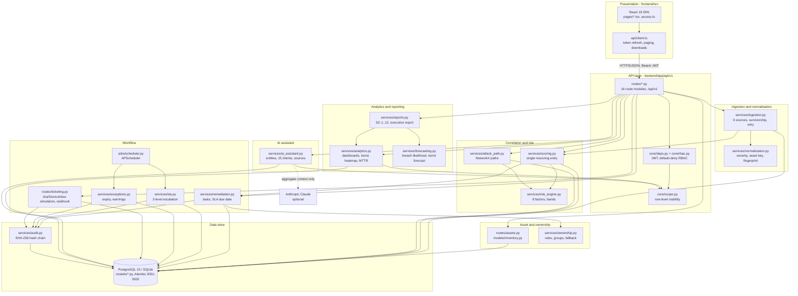
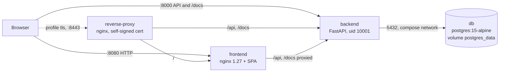
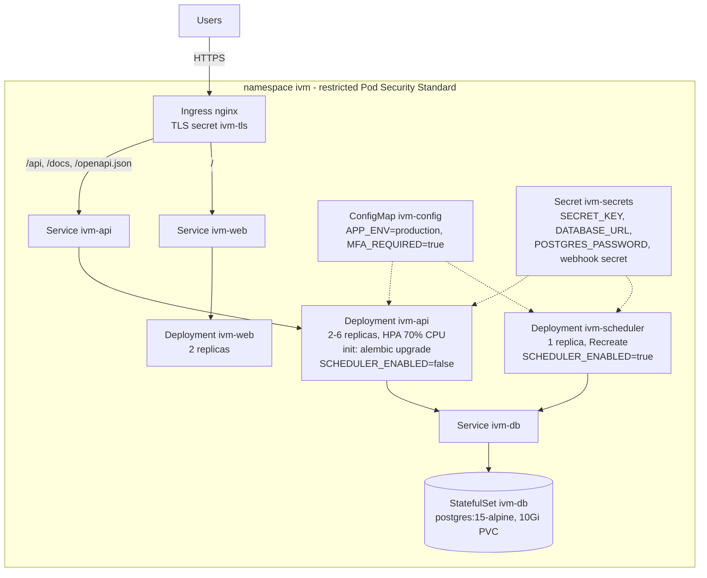

# Solution Architecture

This document describes the architecture of the IVM platform as implemented in the repository. File paths are relative to the repository root. The system is an academic prototype that uses synthetic data only. It is not production-ready.

## 1. Architecture overview

IVM is a layered, API-first web application:

- A **React 18 + TypeScript single-page application** (`frontend/src`) built with Vite and served by nginx.
- A **FastAPI service** (`backend/app`) exposing a versioned REST API under `/api/v1` (104 operations, OpenAPI at `/openapi.json`, snapshot in `docs/evidence/openapi.json`).
- **Domain services** (`backend/app/services`) holding all business logic: ingestion, normalisation, scoring, attack paths, ownership, remediation, SLA, exceptions, analytics, forecasting, reports, AI and audit.
- A **relational store** accessed through SQLAlchemy 2 and versioned with Alembic: PostgreSQL 15 in containers, SQLite for local development and tests.
- An **in-process scheduler** (APScheduler) for SLA escalation and exception expiry. It can be disabled per process and run as a single dedicated instance.
- An **optional external LLM** (Anthropic Claude) that only rephrases answers the offline assistant has already computed.

Route modules authenticate and authorise every request, validate input with pydantic and call services. Services own the transactions and audit writes. The browser holds no business rules beyond hiding navigation the user's permissions do not allow.

## 2. Component view (specification section 12 layers)

| Section 12 layer | Module(s) | Responsibility |
|---|---|---|
| Ingestion | `services/ingestion.py`, `routes/imports.py`, `routes/system.py` (threat-intel import) | Parse CSV/JSON (max 10 MB), keep every row as `RawFinding`, isolate row failures in savepoints, retry failed rows into a linked batch |
| Normalisation | `services/normalization.py` | Severity aliases, asset key (hostname/FQDN/URL first label, IPv4 kept whole), SHA-256 fingerprint of asset id + CVE or title |
| Asset and ownership | `routes/assets.py`, `models/inventory.py`, `services/ownership.py` | Inventory, criticality attributes, asset connections, ordered ownership rules with fallback |
| Data store | `models/{organization,inventory,vulnerabilities,remediation,audit}.py`, `backend/alembic/versions/0001_foundation.py`, `0002_audit_chain_and_workflow.py` | Relational schema; append-only audit triggers |
| Correlation | `services/ingestion.py` (`_process_row`, `_apply_survivorship`) | Duplicate detection, provenance in `finding_sources`, survivorship, reopen on re-detection |
| Risk scoring | `services/risk_engine.py`, `services/scoring.py`, `services/attack_path.py`, `routes/risk.py`, `routes/config.py` | Pure eight-factor scorer, single rescoring entry point, versioned scoring configuration, what-if, attack-path influence |
| Workflow | `services/remediation.py`, `services/sla.py`, `services/exceptions.py`, `routes/tasks.py`, `routes/exceptions.py`, `routes/ticketing.py`, `jobs/scheduler.py` | Tasks, SLA, escalation, exceptions, simulated ticketing |
| Analytics | `services/analytics.py`, `services/forecasting.py`, `services/reports.py`, `routes/dashboards.py`, `routes/reports.py` | Role dashboards, trend, heatmap, MTTR, SLA compliance, forecasts, success criteria, executive report |
| AI | `services/ai_assistant.py`, `routes/ai.py` | Offline question answering scoped to the user; optional Claude rephrasing |
| API | `api/v1/router.py`, `api/v1/routes/*.py`, `api/v1/common.py`, `core/deps.py`, `core/rbac.py`, `core/scope.py`, `main.py` | Versioned REST, authentication, default-deny authorisation, error envelope, security headers |

## 3. Technology choices

| Concern | Choice | Rationale |
|---|---|---|
| API framework | Python 3.12, FastAPI | Typed request validation with pydantic, generated OpenAPI documentation (TO-7), dependency injection for authentication |
| Persistence | SQLAlchemy 2, Alembic; PostgreSQL 15 (containers), SQLite (local/test) | Parameterised ORM queries; versioned migrations; the same code runs on both engines, so tests need no external database |
| Scheduling | APScheduler `BackgroundScheduler` | No extra broker for a prototype; a `SCHEDULER_ENABLED` flag allows exactly one scheduler when scaled out |
| Graph analysis | networkx | Simple-path search over a few hundred assets fits in memory; no graph database to operate. Graph exportable as Cypher or GraphML |
| Authentication | PyJWT (HS256), bcrypt, pyotp, cryptography (Fernet) | Short-lived access tokens with rotating refresh tokens; standard password hashing; TOTP MFA; MFA secrets encrypted at rest |
| AI | Rule-based assistant; optional `anthropic` SDK | Works offline and deterministically for the demo; answers always cite the rows used; the LLM can only rephrase |
| Frontend | React 18, TypeScript, Vite, React Query | Typed client, caching and server-side paging (`X-Total-Count`); fast build |
| Packaging | Docker images, docker-compose, Kubernetes manifests | One-command local stack; reference cloud-native deployment |
| CI | GitHub Actions (`.github/workflows/ci.yml`) | Lint, type check, tests with a 70% coverage gate, bandit, pip-audit, npm audit, build, Playwright E2E, docker build, gitleaks |

## 4. Deployment views

### 4.1 Local development (`scripts/dev.sh`)

No Docker is needed. The script creates `.env` from `.env.example` with a random `SECRET_KEY` and a SQLite database (`sqlite:///./ivm_local_demo.sqlite`), creates a virtual environment, installs the backend and frontend dependencies, runs `alembic upgrade head`, then starts Uvicorn on `127.0.0.1:8000` and the Vite dev server on `:5173`. This is the configuration in which the evidence in `docs/evidence/` was collected.

### 4.2 docker-compose (`docker-compose.yml`)

- `db` has a `pg_isready` health check. `backend` starts only when it is healthy, runs `alembic upgrade head` and then Uvicorn. `frontend` starts only when `backend` is healthy.
- The backend image (`backend/Dockerfile`) generates the synthetic dataset at build time and runs as non-root user 10001. On first start the application seeds an empty database (`app/db/seed.py`).
- The optional `tls` profile (`docker compose --profile tls up`) adds an nginx reverse proxy on 8443 using `infra/tls/nginx.conf` (TLS 1.2/1.3, HSTS). The certificate is self-signed and is created with `infra/tls/generate-local-cert.ps1`.
- Defaults such as `SECRET_KEY` and `POSTGRES_PASSWORD` are demo values with `APP_ENV=development`. They must be overridden for any shared environment. The settings validator refuses a weak `SECRET_KEY` outside development and test.
- Status: compose configuration and image builds are checked in CI. The compose stack has not been run on the development machine because Docker was not installed.

### 4.3 Kubernetes reference (`deploy/k8s`)

- API and scheduler pods run as non-root with a read-only root filesystem, `RuntimeDefault` seccomp and all capabilities dropped.
- NetworkPolicies deny all ingress by default, allow the ingress controller namespace to reach the API and web pods, and allow only the API and scheduler pods to reach PostgreSQL on 5432.
- The production ConfigMap sets `MFA_REQUIRED=true`, which makes MFA mandatory for Platform Administrators, Security Architects and Vulnerability Managers.
- Status: the manifests have been parsed as YAML but never applied to a cluster. See section 9 for known gaps.

## 5. Security architecture

| Control | Implementation |
|---|---|
| Authentication | `POST /api/v1/auth/login` with bcrypt verification (a dummy hash keeps timing equal for unknown e-mails); HS256 JWT access token valid for 15 minutes; refresh token rotated on every use and stored server-side as a SHA-256 hash; logout and password change revoke the refresh token (`routes/auth.py`) |
| Account protection | Lockout for 15 minutes after 5 failures; login rate limit (default 10 per minute) and AI rate limit (default 20 per minute) per client IP (`api/v1/common.py`, `_limit`) |
| MFA | TOTP (pyotp) for any user who enables it; mandatory for privileged roles when `MFA_REQUIRED=true`; rotation or disable require a current code; secrets encrypted with Fernet using a key derived from `SECRET_KEY` (`core/security.py`) |
| Authorisation | 9 roles x 28 permissions (`core/rbac.py`). `get_current_user` in `core/deps.py` maps every authenticated request to a least-privilege permission (`permission_for_request`) and denies by default; routes add explicit `require_permission` checks |
| Row-level scope | `core/scope.py` is the only visibility rule set and is used by routes, analytics and the AI assistant, so every screen shows the same numbers for a user |
| Segregation of duties | Self-approval of exceptions blocked; long-term exceptions only by Security Architects; administrators cannot approve exceptions or demote or deactivate themselves |
| Input handling | pydantic validation (`extra=forbid` on asset payloads); 10 MB upload limit and CSV/JSON only; CVSS range checks; CSV exports neutralise spreadsheet formulas |
| Transport and browser | Security headers and CSP on every response (relaxed only for `/docs` and `/redoc`); CORS allow-list in `main.py`; TLS via the compose `tls` profile or the Kubernetes ingress |
| Audit | Every configuration, ownership, exception, asset, ticket and user change is written to `audit_logs` with a SHA-256 hash chain (`services/audit.py`); a PostgreSQL advisory lock serialises appends; migration 0002 adds triggers rejecting UPDATE and DELETE; `GET /api/v1/audit/verify` recomputes the chain |
| Secrets | From the environment or a Kubernetes Secret; weak `SECRET_KEY` rejected outside development; nothing secret in the repository (gitleaks in CI) |
| Error handling | A uniform error envelope; unhandled exceptions are logged with the request id and returned as a generic 500; `X-Request-ID` echoed on every response |

Trust boundaries: (1) the browser is untrusted; (2) imported files are untrusted input; (3) the API to database link is internal to the compose network or the namespace; (4) the inbound ticketing webhook is untrusted until its HMAC signature verifies; (5) calls to Anthropic leave the platform boundary and carry only the question, up to three earlier questions and aggregate synthetic context. The threat model is in `07_Threat_Model.md`.

## 6. Scalability, availability and backup

| Aspect | Approach | Limits |
|---|---|---|
| Horizontal scaling | The API is stateless apart from in-memory rate-limit counters; Kubernetes runs 2-6 replicas with an HPA. The scheduler is disabled on API replicas and runs as a single `Recreate` deployment, so jobs never run twice | Rate limits are per process, so the effective limit grows with replicas |
| Database | Indexed filter columns; dashboard aggregation in SQL; server-side paging with `X-Total-Count` | Single PostgreSQL instance; no replica or failover in the manifests |
| Performance | Dashboard mean 0.500 s, p95 0.514 s on the seeded dataset (`docs/evidence/dashboard-latency.txt`) against a 3 s target | Measured on SQLite on a developer machine |
| Availability | Health checks: `/health` (checks the database) and `/api/v1/health`; compose `depends_on` with health conditions; Kubernetes readiness and liveness probes; failed migrations stop the container before it serves traffic | |
| Reliability | Each import row is processed in its own savepoint; failed rows are stored with the error and can be retried (`POST /api/v1/imports/{id}/retry`) | |
| Backup and restore | `backend/scripts/backup.sh` and `restore.sh` support PostgreSQL (`pg_dump` custom format, after removing the SQLAlchemy driver suffix) and SQLite (online `.backup`), and print a SHA-256 checksum. The Kubernetes README suggests running the backup from a CronJob | |

## 7. Integration

| Integration | Direction | Design |
|---|---|---|
| Simulated Jira / ServiceNow | Outbound (simulated) | `POST /api/v1/ticketing/{jira-sim or servicenow-sim}/issues` creates one active ticket per task and system, scoped to the user's assets and audited; transitions keep the task status in step (`routes/ticketing.py`) |
| Ticketing webhook | Inbound | `POST /api/v1/integrations/ticketing/webhook` with `X-IVM-Signature: sha256=<HMAC-SHA256 of body>` using `INTEGRATION_WEBHOOK_SECRET`; constant-time comparison; 64 KB body limit; returns 503 when no secret is configured; updates ticket and task; audited |
| Anthropic Claude (optional) | Outbound | Enabled only when `ANTHROPIC_API_KEY` is set; model from `ANTHROPIC_MODEL` (default `claude-haiku-4-5-20251001`); 8 s timeout; 400 max tokens; a system prompt restricts the model to the supplied context; any error falls back to the offline answer; `used_llm` is reported and logged in `ai_query_logs` |
| Threat intelligence | Inbound file | `POST /api/v1/threat-intel/import` and `/threat-intel/import/file` update the CVE catalogue and rescore affected findings |
| REST consumers | Both | Versioned `/api/v1`, OpenAPI document, JSON error envelope, CSV exports |

## 8. Key architecture decisions

| ID | Decision | Alternatives considered | Rationale and consequences |
|---|---|---|---|
| ADR-01 | Modular monolith (one FastAPI service, layered into routes and services) | Microservices | One deployable unit suits the team size and timebox; service modules keep clear seams for later extraction |
| ADR-02 | Pure scoring function plus a single rescoring entry point (`scoring.rescore_findings`) | Scoring logic in each caller | Every trigger (import, configuration change, asset edit, threat-intel import, manual recalculation) uses identical inputs; fixed defect where a general rescore dropped attack-path influence |
| ADR-03 | Factor weights expressed as maximum points that total 100, versioned in `ScoringConfig` | Free-form multipliers | Scores stay on 0-100 and each factor's contribution is directly explainable; history records the configuration version |
| ADR-04 | Attack paths in NetworkX, stored as `attack_paths` rows | Graph database (Neo4j) | No extra infrastructure for about 300 assets; Cypher and GraphML export keeps a path to a graph database open |
| ADR-05 | Central default-deny permission mapping in `get_current_user` plus per-route checks | Per-route checks only | A new route is denied unless mapped; the browser receives the same permission list to drive navigation |
| ADR-06 | One row-level scope module (`core/scope.py`) | Scope logic in each route | Fixed defect where three inconsistent rule sets showed different data on different screens and to the AI |
| ADR-07 | Hash-chained audit log plus database triggers | Plain audit table | Tamper evidence verifiable through the API; database-level append-only enforcement |
| ADR-08 | Offline-first AI with optional LLM rephrasing | LLM-only assistant | Deterministic, testable answers with sources; no data leaves the platform by default; works without a key |
| ADR-09 | In-process APScheduler with an enable flag | Celery or an external job runner | No broker for the prototype; one dedicated scheduler deployment when scaled |
| ADR-10 | SQLite for local development and tests, PostgreSQL for containers | PostgreSQL everywhere | Runs on a machine without Docker; migration 0002 provides triggers for both dialects; CI covers the PostgreSQL build path |
| ADR-11 | Keep failed import rows and retry them | Reject the whole file or drop failed rows | Meets the reliability NFR: no data loss, and errors are visible and recoverable |

## 9. Known architectural gaps

- The refresh token is held in an HttpOnly, SameSite=Strict cookie (`ivm_refresh`, path `/api/v1/auth`; Secure outside development); the short-lived access token is kept in memory and mirrored in `sessionStorage` for page reloads.
- Rate limits are in-memory, per process and keyed on the client IP. Behind a proxy all users may share one address. A shared store (for example Redis) and a trusted forwarded-for header are needed.
- The audit triggers can be dropped by a database superuser. External WORM storage is recommended.
- Kubernetes manifests are untested. Issues seen on review: the `ivm-web` pod sets no `runAsNonRoot` or seccomp profile and the nginx image runs as root on port 80, so the restricted Pod Security Standard would reject it; `frontend/nginx.conf` proxies to the host name `backend`, which does not exist in the namespace (the Service is `ivm-api`); the backend image has no `pg_dump`, so a backup CronJob needs a PostgreSQL client image.
- The startup seeding check (`seed_demo`) is not guarded against concurrent first starts of several API replicas.
- Single database instance with no high-availability configuration.
