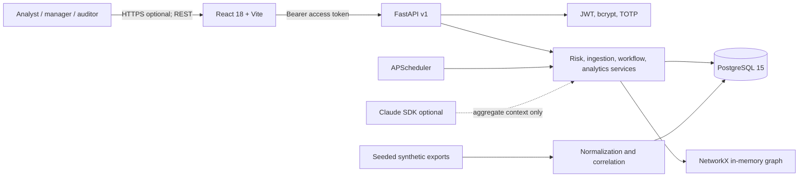
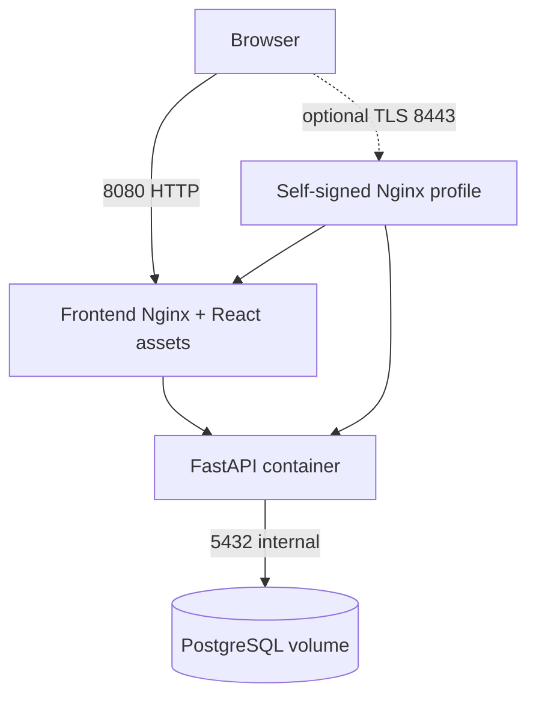
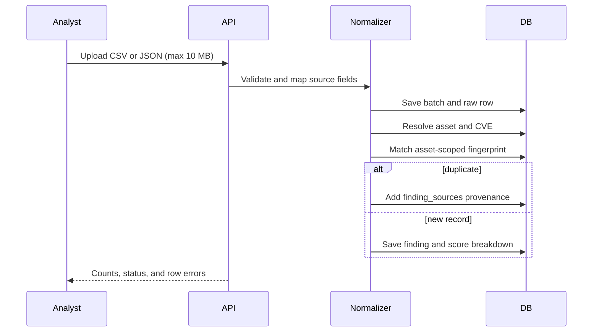
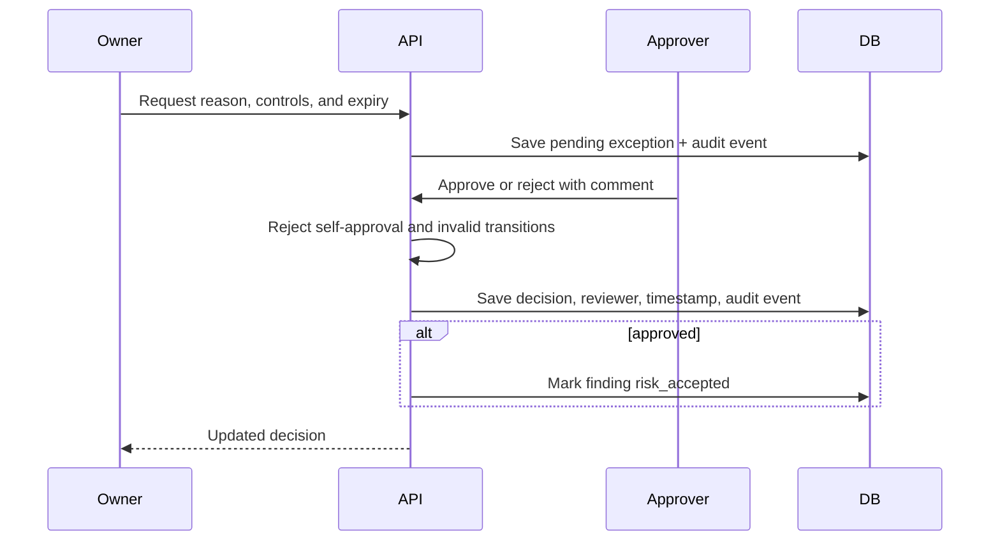

# Solution Architecture

## Overview

The browser UI calls a versioned FastAPI service. The service applies authentication and authorization, invokes domain services, and stores records in PostgreSQL through SQLAlchemy. Alembic owns schema creation. APScheduler runs local SLA and exception-expiry jobs. NetworkX builds an in-memory graph from asset-connection rows. Synthetic exports are generated at image build time with a fixed seed, and an optional Claude client is used only when an environment API key is supplied.

## Deployment diagram

The default Compose deployment exposes the UI on port 8080 and API/Swagger on 8000. The optional TLS profile terminates HTTPS on 8443. The self-signed certificate is for a local demo and will generate a browser trust warning.

## Import-to-score sequence

## Exception-approval sequence

## Trust boundaries

1. The browser is untrusted; every API request is validated and authenticated.
2. The Compose network is an isolated local service boundary; only mapped ports are reachable from the host.
3. PostgreSQL stores application records and encrypted MFA secrets; the database volume is not production encrypted by this demo.
4. Optional Anthropic calls cross the local boundary. Only a short question and aggregate synthetic context are sent, with a bounded timeout and fallback.
5. Imported files are untrusted input and are size- and extension-checked before parsing.
