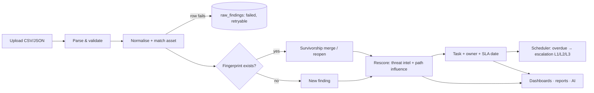
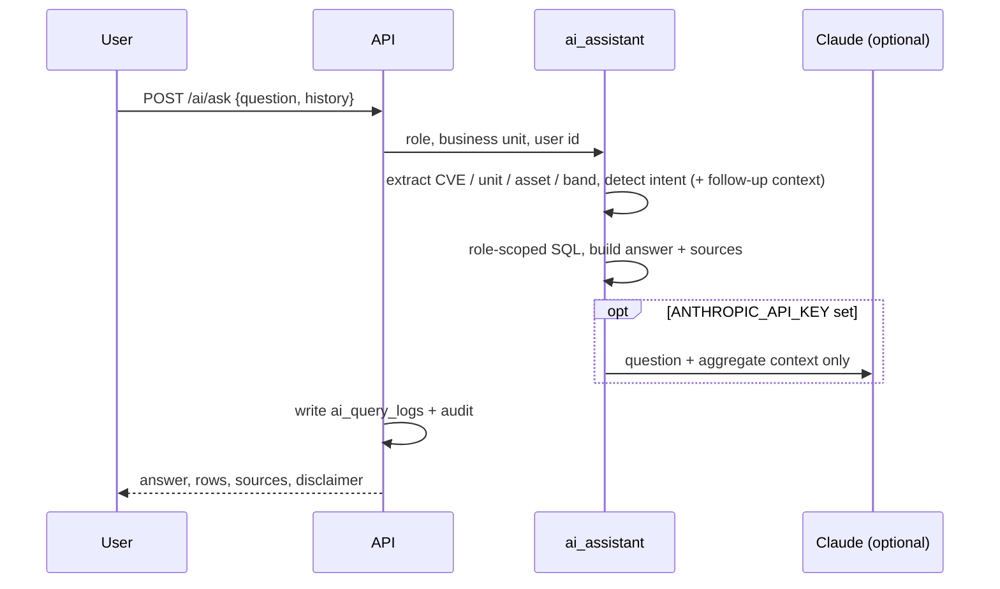

# High-Level Design

See `02_Solution_Architecture.md` for the component view and `04_LLD.md` for module internals.

## Subsystems

| Subsystem | Responsibility | Main code |
|---|---|---|
| Identity & access | Login, MFA, token rotation, 9 roles × 28 permissions, row-level scope | `app/api/v1/routes/auth.py`, `core/rbac.py`, `core/scope.py`, `core/deps.py` |
| Asset & ownership | Inventory, criticality context, business units/services, owners | `routes/assets.py`, `services/ownership.py` |
| Ingestion & correlation | Parse six sources, normalise, match assets, de-duplicate, survivorship, retry | `services/ingestion.py`, `services/normalization.py`, `routes/imports.py` |
| Threat intelligence | CVE catalog, KEV/EPSS/exploit/ransomware signals, feed import with rescoring | `routes/system.py` (threat-intel), `services/scoring.py` |
| Risk engine | Eight-factor score, bands, versioned weights, what-if, single rescore path | `services/risk_engine.py`, `services/scoring.py`, `routes/risk.py`, `routes/config.py` |
| Attack paths | Asset graph, entry→crown-jewel paths, path influence, graph export | `services/attack_path.py`, `routes/attack_paths.py` |
| Remediation workflow | Tasks, SLA dates, status machine, evidence, reassignment, escalation, tickets | `services/remediation.py`, `services/sla.py`, `routes/tasks.py`, `routes/ticketing.py` |
| Exceptions | Request, review (segregation of duties), revoke, expiry, review packs | `routes/exceptions.py`, `services/exceptions.py` |
| Analytics & reporting | Role dashboards, trend, heatmap, MTTR, SLA, forecasts, SC scorecard, board report | `services/analytics.py`, `services/forecasting.py`, `services/reports.py` |
| AI assistant | Entity/intent NLQ, recommendations, explanations, executive summary | `services/ai_assistant.py`, `routes/ai.py` |
| Audit | Hash-chained, append-only trail with verification | `services/audit.py`, `routes/audit.py` |
| Scheduler | SLA checks every 15 min, exception expiry hourly | `jobs/scheduler.py` |

## Main data flow



## Key sequences

```mermaid
sequenceDiagram
  participant A as Analyst / Owner
  participant M as Manager / Architect
  participant API
  participant DB
  A->>API: POST /exceptions (justification, controls, expiry)
  API->>DB: insert pending + audit (hash-chained)
  M->>API: POST /exceptions/{id}/approve
  API->>API: reject if approver == requester; long-term needs architect
  API->>DB: approved, finding risk_accepted, audit
  Note over API,DB: scheduler expires it later and reopens the finding and SLA
```



## Role model

Platform admin (configuration, users), security analyst (triage, imports), vulnerability manager (SLA, temporary
exceptions, scheduler, asset criticality), security architect (attack paths, long-term exceptions), IT asset owner and
system administrator (own tasks), business-unit manager (unit scope), executive/CISO (portfolio and reports), auditor
(read-only evidence). Visibility follows `core/scope.py`; actions follow `core/rbac.py`.
