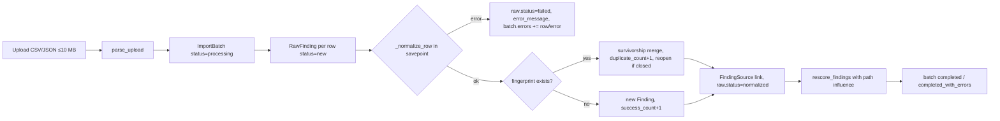
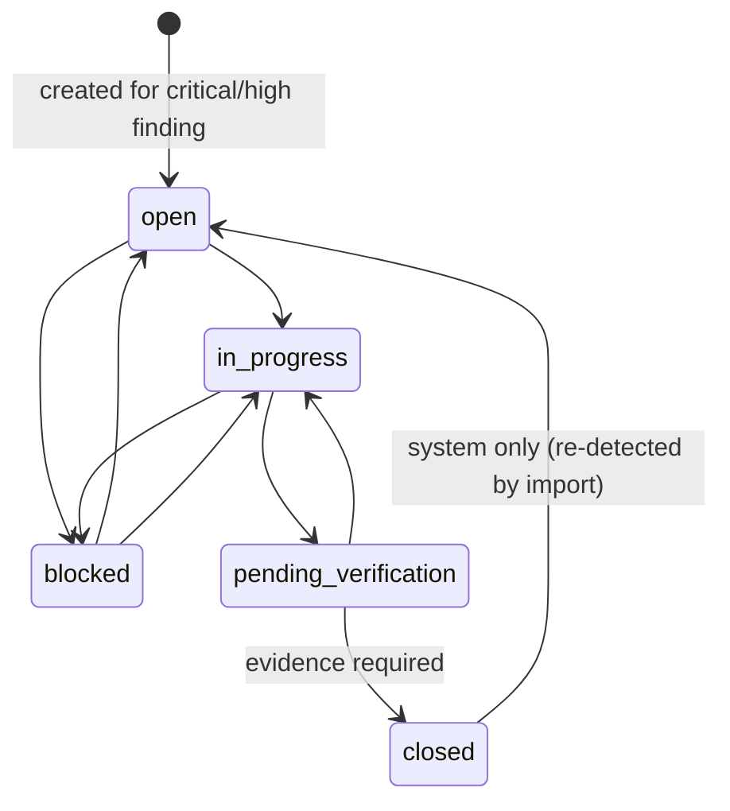
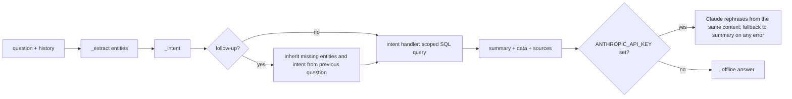

# Low-Level Design

This document describes how each module of the Intelligent Vulnerability Management (IVM) platform works at code level. Every rule, constant and formula below is taken from the source in `backend/app` and `frontend/src`; file paths are given so each statement can be checked. All data processed by the platform is synthetic.

Related documents: `03_HLD.md` (component view), `05_Data_Model.md` (tables), `06_API_Specification.md` (endpoints).

## 1. Module map

| Layer | Module | Responsibility |
|---|---|---|
| Entry point | `app/main.py` | Builds the FastAPI app, CORS allow-list, error envelope, request-ID and security-header middleware, `/health`; on start-up runs `seed_demo` on an empty database and starts the scheduler when `SCHEDULER_ENABLED=true`. |
| Configuration | `app/core/config.py` | Pydantic settings from environment/`.env`. Refuses a default or short (< 32 characters) `SECRET_KEY` when `APP_ENV` is not `development`/`test`. |
| Access control | `app/core/deps.py`, `app/core/rbac.py` | JWT validation and central default-deny: every authenticated request is mapped to one permission by `permission_for_request`. Routes add their own `require_permission` checks where they need a stricter permission. |
| Row-level scope | `app/core/scope.py` | `asset_condition(user)`: the one SQL rule for which assets (and therefore findings, tasks, exceptions, paths) a user can see. |
| Secrets | `app/core/security.py` | Request IDs (`token_urlsafe(12)`); Fernet encryption of TOTP secrets with a key derived as `SHA-256(SECRET_KEY)`. |
| Time | `app/core/timeutil.py` | `as_utc` treats naive datetimes (SQLite) as UTC so they compare with aware ones (PostgreSQL). |
| API | `app/api/v1/routes/*.py`, `app/api/v1/common.py` | HTTP mapping, validation, scope checks, auditing, CSV helpers, paging, in-process rate limiter. |
| Services | `app/services/*.py` | Business logic (sections 2–13). |
| Jobs | `app/jobs/scheduler.py` | APScheduler `BackgroundScheduler` (UTC): SLA check every 15 minutes, exception expiry every hour. `POST /api/v1/jobs/run` runs both on demand. |
| Persistence | `app/models/*.py`, `alembic/versions/*` | SQLAlchemy 2 models and migrations (see `05_Data_Model.md`). |
| Seed | `app/db/seed.py` | Loads `backend/data/synthetic/*` into an empty database (only when the `assets` table is empty). |

## 2. Risk engine (`app/services/risk_engine.py`)

`score_finding(finding, asset, intel, on_attack_path, weights, band_thresholds, reachable_from_exposed)` is a pure function. It returns `RiskResult(score, band, breakdown)`, where `breakdown` is a list of `{factor, points, max_points, reason}` for the eight factors.

### 2.1 Raw factor points (default scale)

Each factor is first computed on its default scale (the default maximum points):

| # | Factor (`factor` key) | Default max | Raw points |
|---|---|---|---|
| 1 | `cvss_technical_severity` | 25 | `clamp(cvss, 0, 10) / 10 × 25` (finding `cvss_score`; missing = 0) |
| 2 | `asset_criticality` | 15 | `min(15, tier_points + 3 if crown jewel + 2 if customer-facing)`, where tier points are 1→15, 2→12, 3→8, 4→4, 5→2 (tier clamped to 1–5, missing = 3) |
| 3 | `internet_exposure` | 10 | 10 if `internet_exposed`; 6 if `reachable_from_exposed`; otherwise 0 |
| 4 | `exploitability` | 10 | `max(maturity_points, clamp(epss, 0, 1) × 10)`, maturity points none 0, poc 4, functional 7, weaponized 10 (unknown = 0) |
| 5 | `threat_intelligence` | 15 | `min(15, 8 if in KEV + 4 if actively exploited + 3 if ransomware-associated)` |
| 6 | `data_sensitivity` | 10 | 10 if `has_sensitive_data`, otherwise 0 |
| 7 | `regulatory_impact` | 5 | 5 if regulatory tags include `PCI-DSS` or `SOX` (case-insensitive); 3 for any other tag; 0 for none |
| 8 | `attack_path_influence` | 10 | `path_fraction × 10`, where `path_fraction` is 1.0 when `on_attack_path is True`, otherwise `clamp(float(on_attack_path), 0, 1)` |

Threat-intelligence inputs (`epss_score`, `exploit_maturity`, `in_kev_list`, `actively_exploited`, `ransomware_used`) come from the `vulnerability_catalog` row linked to the finding (`scoring.intel_from_catalog`). Findings without a CVE link receive 0 for factors 4 and 5.

Note: no production caller passes `reachable_from_exposed`, so in practice factor 3 is either 10 or 0 (see section 14).

### 2.2 Configurable maximum points

The active `scoring_config.weights` row holds the maximum points for each factor; the eight values must be non-negative and sum to 100 (`PUT /config/scoring`, `POST /risk/what-if`). Each raw value is rescaled:

```
points_f = min(max_f, raw_f / default_max_f × max_f)
score    = round(clamp(Σ points_f, 0, 100), 1)
```

The default `max_points` are 25 / 15 / 10 / 10 / 15 / 10 / 5 / 10 (`DEFAULT_MAX_POINTS`).

### 2.3 Bands

Default thresholds (`DEFAULT_THRESHOLDS`) are merged with the active configuration's `band_thresholds`:

| Band | Condition |
|---|---|
| critical | score ≥ 80 |
| high | 60 ≤ score < 80 |
| medium | 40 ≤ score < 60 |
| low | score < 40 |

The scanner-reported `severity` is stored and shown but is **not** an input to the score. This is why SC-4 counts findings whose band differs from scanner severity.

### 2.4 Worked example

Here is a finding with CVSS 7.5, on a tier-2, customer-facing, internet-exposed asset that holds sensitive data and has a `SOX` tag. Its CVE has `functional` exploit maturity, EPSS 0.42, and is in KEV but not actively exploited or ransomware-associated. The scores below come from running `score_finding` with default weights:

| Factor | Calculation | Points / max |
|---|---|---|
| CVSS | 7.5 / 10 × 25 | 18.75 / 25 |
| Asset criticality | 12 (tier 2) + 2 (customer-facing) | 14.00 / 15 |
| Internet exposure | exposed | 10.00 / 10 |
| Exploitability | max(7 functional, 0.42 × 10 = 4.2) | 7.00 / 10 |
| Threat intelligence | 8 (KEV) | 8.00 / 15 |
| Data sensitivity | flagged | 10.00 / 10 |
| Regulatory impact | SOX | 5.00 / 5 |
| Attack path | not on a path | 0.00 / 10 |
| **Total** | | **72.8 → high** |

If the attack-path model gives this finding a path influence of 0.62, factor 8 becomes 6.2 and the score rises to **79.0** (still high, just below 80). With a custom configuration that moves 5 points from CVSS to threat intelligence (20/15/10/10/20/10/5/10), CVSS becomes 7.5/10 × 20 = 15.0 and threat intelligence becomes 8/15 × 20 = 10.67, for a total of **71.7**.

## 3. Rescoring pipeline (`app/services/scoring.py`)

`rescore_findings(db, findings, config=None, influence=None, record_history=True, create_tasks=True)` is the single entry point for re-scoring, so every caller uses the same inputs:

1. **Configuration:** the active `scoring_config` (or the defaults, version 1).
2. **Threat context:** `intel_for(finding)` reads all five catalog signals, including `exploit_maturity`.
3. **Path influence:** `path_influence(db)` reads the stored `attack_paths`. For each path, `value = min(1, path_risk_score / 100)`, and every finding id in `path_finding_ids` keeps the maximum value over all paths.
4. The finding is scored with `on_attack_path = influence`. When the influence is non-zero, a second score without the path is computed, and the `attack_path_influence` breakdown entry is extended with `base_score`, `final_score` and `path_influence`.
5. `risk_score`, `risk_band` and `risk_breakdown` are updated, and a `risk_score_history` row is written (`config_version` = active version).
6. When `create_tasks` is set and the finding is `open` with band critical/high, `remediation.create_task_for_finding` is called. It is idempotent: there is one task per finding.

The function returns the number of findings whose band changed.

| Caller | Findings rescored |
|---|---|
| Ingestion (`ingestion._run`) | New findings, and duplicates whose severity, CVSS, CVE link or status changed |
| `PUT /config/scoring` | All findings (new config version) |
| `POST /risk/recalculate` | All findings |
| `PATCH /assets/{id}` (and `PUT …/criticality`) | Non-closed findings on the asset, when a risk field changed (`criticality_tier`, `internet_exposed`, `is_customer_facing`, `is_crown_jewel`, `has_sensitive_data`, `regulatory_tags`) |
| Threat-intel import (`/threat-intel/import`, `/threat-intel/import/file`) | Non-closed findings linked to updated CVEs |

`POST /risk/what-if` does **not** use this pipeline. It scores open findings in scope in memory with candidate weights (and optionally a different tier for one finding), without path influence and without saving anything. It returns the top 20.

## 4. Attack-path model (`app/services/attack_path.py`)

`recalculate_paths(db)` (called by `POST /attack-paths/recalculate` and at the end of seeding):

1. Builds a `networkx.DiGraph` with every asset as a node and every `asset_connections` row as a directed edge (source → target).
2. **Base pass:** scores every `open` finding with no path influence and writes the base score to the finding.
3. Deletes all stored `attack_paths`.
4. **Entries** are internet-exposed assets. **Targets** are assets that are crown jewels *or* hold sensitive data.
5. For each entry/target pair that is connected, it enumerates `all_simple_paths` with `cutoff=5` (at most 5 edges) and keeps the first **3 plausible** routes. A route is plausible only if **every** asset on it has at least one open finding with CVSS ≥ 4.
6. **Route score:** for each node, the highest base-scoring eligible finding is chosen. Then:

   ```
   hop_count  = max(1, nodes − 1)
   path_score = Σ chosen base scores / hop_count
   path_score = min(100, path_score × (1 + 0.1 × max(0, high_hops − 1)))
   ```

   `high_hops` is the number of nodes whose chosen finding is high or critical. `path_finding_ids` stores *all* eligible findings on the route, not only the chosen ones.
7. **Influence:** `min(1, path_score / 100)`. Each finding keeps its maximum over all paths.
8. **Final pass:** findings with influence are rescored with `on_attack_path = influence`, adding up to the configured maximum for `attack_path_influence`. The breakdown records `base_score`, `final_score` and `path_influence`. A history row is written for every open finding, then the transaction commits.

The route score divides by edges rather than nodes, so a two-node route of two 50-point findings scores 100 (see section 14). Path recalculation does not create remediation tasks for findings it raises into high/critical. They are created the next time those findings pass through `rescore_findings`.

The read endpoints average the stored `base_score`/`final_score` of a path's findings (`attack_paths._path_score_values`). The graph endpoint returns per-asset base/final maxima, and `GET /attack-paths/export` produces Cypher (Neo4j) or GraphML.

## 5. Ingestion (`app/services/ingestion.py`)

### 5.1 Pipeline



- `parse_upload` rejects empty or > 10 MB uploads and accepts only `.csv` (UTF-8 with optional BOM, `csv.DictReader`) or `.json`. JSON must be an array, or an object holding `findings` or `items` (otherwise the object is treated as one record).
- Supported `source_type` values are `scanner`, `cspm`, `pentest`, `container`, `identity` and `easm`.
- Each row runs in its own savepoint (`db.begin_nested()`), so one bad row never rolls back the batch. Every input row is stored as a `raw_findings` row, including failed rows.
- The asset lookup (`_Context`) indexes every non-retired asset under `asset_key(name)`, `asset_key(hostname)` and `asset_key(ip_address)`.
- The route `POST /imports/{source_type}` writes an `import_completed` audit record.

### 5.2 Field mapping

`_normalize_row` takes the first non-empty value from each list of candidate keys:

| Normalised field | Candidate keys, in order | Rule |
|---|---|---|
| Asset target | `host`, `hostname`, `target`, `resource_id`, `image_name`, `asset`, `fqdn`, `domain`, `url`, `ip` | Matched by `asset_key`; no match → row fails with `Asset not found for target '…'` |
| CVE | `cve`, `cve_id`, `CVE`, `vulnerability` | Upper-cased; linked to `vulnerability_catalog` when known |
| Title | `plugin_name`, `rule_title`, `finding_title`, `issue`, `title`, `issue_type`, `service` | Falls back to the CVE id, then `Finding`; truncated to 300 characters |
| Severity | `severity`, `risk_rating`, `risk` | `normalize_severity` (section 6) |
| CVSS | `cvss`, `cvss_score`, `cvss_base_score` | Falls back to the catalog base score; outside 0–10 → row fails; none → stored as 0.0 |
| Description | `description`, `details`, `rule_title`, `evidence` | Falls back to `Synthetic imported finding` |
| Finding type | — | `cve` when a CVE is present; otherwise identity → `identity_issue`, easm → `external_exposure`, pentest → `pentest_issue`, anything else → `misconfiguration` |

How the synthetic source files map to these fields:

| Source | Synthetic file (columns) | Target | Title | Severity | CVE / CVSS | Columns not mapped (kept in `raw_payload`) |
|---|---|---|---|---|---|---|
| scanner | `scanner_export.csv` (`cve, cvss, first_found, host, ip, plugin_name, port, severity`) | `host` (`ip` only when no earlier key is set) | `plugin_name` | `severity` | `cve`, `cvss` | `first_found`, `port` |
| cspm | `cspm_findings.json` (`resource_id, resource_type, rule_id, rule_title, severity, region, status`) | `resource_id` | `rule_title` (also the description) | `severity` | none → CVSS 0 | `resource_type`, `rule_id`, `region`, `status` |
| pentest | `pentest_report.json` (`target, finding_title, risk_rating, description, cwe, tester, date`) | `target` | `finding_title` | `risk_rating` | none → CVSS 0 | `cwe`, `tester`, `date` |
| container | `container_k8s_findings.json` (`image_name, namespace, pod, cve_id, package, fixed_version, severity`) | `image_name` | CVE id | `severity` | `cve_id`; CVSS from catalog | `namespace`, `pod`, `package`, `fixed_version` |
| identity | `identity_findings.csv` (`account, asset, issue, severity`) | `asset` | `issue` | `severity` | none → CVSS 0 | `account` |
| easm | `easm_findings.json` (`url, issue_type, risk, evidence, observed_at`) | `url` (host part) | `issue_type` | `risk` | none → CVSS 0 | `observed_at` |

### 5.3 Correlation and survivorship

A row matches an existing finding when the fingerprint (section 6) is the same, either in the database or earlier in the same batch. The surviving record is updated by `_apply_survivorship`:

| Field | Rule |
|---|---|
| `severity` | Keep the highest (`low < medium < high < critical`) |
| `cvss_score` | Keep the highest reported value |
| `description` | Replace when the incoming text is not the generic placeholder and either the current text is the placeholder or the incoming text is longer |
| `vulnerability_id` | Fill in when missing and the incoming row links a catalog CVE |
| `sources` | Union; the source type is appended once |
| `last_seen` | Set to now |
| Status (regression) | A `closed` finding is reopened: `status=open`, `closed_at=null`, `reopened_count+1`, its closed task is reopened with a fresh SLA due date (`remediation.reopen_task`), and `finding_reopened` / `task_reopened` audit rows are written |

A rescore is scheduled when severity, CVSS, CVE link or status changed. Each matched row adds a `finding_sources` link to its raw row and increments `duplicate_count`.

### 5.4 Failed rows and retry

A failed row keeps its payload, `status=failed` and `error_message` (≤ 500 characters). The batch records `{row, error}` in `errors`, and its status is `completed_with_errors`.

`POST /imports/{id}/retry` calls `retry_failed_rows`. This creates a new batch (`file_name = "retry of <name>"`), moves only the failed raw rows into it, and reprocesses them. Rows that succeed are linked to findings; rows that fail again remain retryable. It returns 409 when the batch has no failed rows. The original batch's counters are not changed.

## 6. Normalisation (`app/services/normalization.py`)

- **Severity:** lower-cased and trimmed, then mapped by alias: `critical, crit → critical`; `high, severe → high`; `medium, moderate → medium`; `low, informational, info → low`. Anything else, or a missing value, becomes `medium`.
- **`asset_key(*values)`:** takes the first value that gives a non-empty key:
  - URLs (`://`) are reduced to their hostname.
  - IPv4 addresses are kept whole.
  - Otherwise the text before the first `/` and `:` is taken, the first DNS label is kept, and non-alphanumerics are removed.
  - Examples: `host001.bank.local → host001`, `HOST001 → host001`, `https://host005.bank.local:8443/ → host005`, `10.0.0.2:443 → 10.0.0.2`, `application-001 → application001`.
  - When nothing matches, the key is `unknown`.
- **`finding_fingerprint(asset_id, cve_id, title)`** = `SHA-256("<asset uuid>|" + lower(trim(cve_id or title)))`, stored as 64 hex characters, unique in `findings.fingerprint`. Because the CVE takes precedence over the title, a scanner row and a container row for the same CVE on the same asset merge into one finding.

## 7. Ownership routing (`app/services/ownership.py`)

`decide_owner(db, asset)` returns `OwnerDecision(user_id, group, reason)`. Precedence:

1. **First matching ownership rule**, taking rules in ascending `priority_order`. `match_value` is compared case-insensitively with the asset's values for `match_field`:

   | `match_field` | Asset values compared |
   |---|---|
   | `business_unit` | BU id and BU name |
   | `business_service` | service id and service name |
   | `asset_type` | `asset_type` |
   | `environment` | `environment` |
   | `tag` | any entry in `regulatory_tags` |

   A rule must assign a user, a group or both; rules with neither are skipped. When a rule sets only a group, the user falls back to the asset's owner. Reason: `rule:<field>=<value>`.
2. **Asset owner** (`owner_user_id`), reason `asset_owner`.
3. **Business-unit manager**: the first active `business_unit_manager` in the asset's BU, reason `business_unit_manager_fallback`.
4. Otherwise `unassigned`.

`remediation.create_task_for_finding` stores `assigned_to_user_id`, `assigned_group` and `assigned_by_rule`. It sets `priority = sla_category = risk band` and `sla_due_date = now + sla_days(band)`: the policy value, or the defaults critical 7, high 15, medium 30, low 90. It writes an `ownership_assigned` audit row. Manual override is `POST /tasks/{id}/assign` (needs `task:manage` and a reason; sets `assigned_by_rule=manual_override`; audited as `ownership_reassigned`).

## 8. SLA monitoring and escalation (`app/services/sla.py`)

`check_overdue_tasks(db)` runs every 15 minutes and on `POST /jobs/run`:

1. It selects tasks whose status is not `closed`, whose `sla_due_date` is set, and whose due date is earlier than now.
2. It skips a task when its finding has an `approved` exception with `requested_expiry_date ≥ now`.
3. `overdue_days = floor(now − due)` in whole days.
4. It looks up thresholds in the `sla_policies` row for the task's `sla_category` (or `priority`):

   ```
   L1 = escalation_level_1_days                 (no policy: 0)
   L2 = max(L1, escalation_level_2_days)         (no policy: 7)
   L3 = L2 + max(7, L2 − L1)
   ```

5. For each level whose threshold is reached and that has no `escalations` row yet, it creates one (idempotent per task and level) and writes an `sla_escalated` audit row.

Seeded policies (`app/db/seed.py`), and the level-3 values they produce:

| Band | SLA days | L1 | L2 | L3 (derived) |
|---|---|---|---|---|
| critical | 7 | 0 | 7 | 14 |
| high | 15 | 0 | 7 | 14 |
| medium | 30 | 15 | 30 | 45 |
| low | 90 | 45 | 90 | 135 |

Recipients (`_recipient`):

| Level | Recipient |
|---|---|
| 1 | If the owner has a business unit: that unit's `head_user_id`, otherwise a `business_unit_manager` of the owner's unit, otherwise one of the asset's unit (may be none). If the task has no owner, or the owner has no unit: the CISO. |
| 2 | A `business_unit_manager` of the asset's unit, otherwise the CISO |
| 3 | The first `executive_ciso` user |

`PUT /config/sla` clamps `sla_days` to 1–365, `L1 ≥ 0` and `L2 ≥ L1`, and is audited as `sla_policy_changed`. Escalations are acknowledged with `POST /escalations/{id}/acknowledge`, by the recipient, a platform admin or a vulnerability manager.

## 9. Exception workflow (`routes/exceptions.py`, `services/exceptions.py`)

```mermaid
stateDiagram-v2
  [*] --> pending: POST /exceptions (exception:request)
  pending --> approved: approve (not requester; role rules)
  pending --> rejected: reject (not requester; role rules)
  approved --> revoked: POST /{id}/revoke
  approved --> expired: hourly job when expiry ≤ now
  rejected --> [*]
  revoked --> [*]
  expired --> [*]
```



| Rule | Implementation |
|---|---|
| Request validation | `justification` 10–2000 characters, `compensating_controls` 5–2000, `exception_type` ∈ {`temporary`, `long_term`}, expiry in the future and ≤ 90 days (temporary) or ≤ 365 days (long-term) from now; finding must be in the requester's scope |
| Segregation of duties | Requester can never review their own request (403 `Self-approval is forbidden`) |
| Who may review | Temporary: `vulnerability_manager` or `security_architect`. Long-term: `security_architect` only. Both need `exception:approve_temporary`; the role checks are in `review_exception` |
| State guard | Only `pending` can be reviewed (409); only `approved` can be revoked (409) |
| Effects | Approve: `approved_at`, reviewer and comment are recorded, and the finding becomes `risk_accepted`. Revoke or expire: a `risk_accepted` finding returns to `open`. Expire also resets a non-closed task to `open` with `sla_due_date = now + policy days` |
| SLA interaction | Tasks whose finding has an unexpired approved exception are not escalated |
| Expiry warnings | `expire_exceptions` writes one `exception_expiry_warning_14d` and one `…_7d` audit row per exception when the days left fall to 14 or below and to 7 or below |
| Audit | `exception_requested`, `exception_approved`, `exception_rejected`, `exception_revoked`, `exception_expired` |
| Review pack | `GET /exceptions/{id}/review-pack` (JSON or HTML) gives the finding, threat intel, asset, task, attack paths, the hash-chained audit trail and six checks: segregation of duties, duration within policy, controls documented (≥ 10 characters), justification documented, not on a modelled attack path, no KEV or active exploitation |

## 10. Remediation task state machine (`routes/tasks.py`)



- `PATCH /tasks/{id}` accepts `status`, `comment` and `evidence_notes`.
- Only the assignee, a `platform_admin` or a `vulnerability_manager` may update a task (403 `Task is assigned to another owner`), and the task must be in the caller's scope.
- An unknown status returns 422. A transition outside `ALLOWED_TRANSITIONS` returns 409 `Invalid task transition: a -> b`. Closing without evidence (in the request or already stored) returns 422.
- **Finding synchronisation:** a closed task closes its finding (and sets `closed_at`). Moving to `in_progress` or `pending_verification` changes an `open` finding to `in_remediation`.
- Every update writes a `task_updates` row and a `task_updated` audit row.
- **System-initiated transitions outside the table:**
  - `reopen_task` (closed → open on re-detection).
  - Exception expiry (any non-closed status → open).
  - Ticket synchronisation: a ticket in `in_progress` sets the task to `in_progress`, and a ticket in `resolved` sets it to `pending_verification`, unless the task is already closed or already at that status. No `task_updates` row is written for this.

## 11. Forecasting (`app/services/forecasting.py`)

### 11.1 SLA-breach likelihood

`learn_history(db)` reads every task with `closed_at` and computes:

- `median_days_by_band[priority]`: the median of `closed_at − created_at`, in days.
- `owner_on_time[owner] = (on_time, total)`, where on time means `closed_at ≤ sla_due_date`.
- `portfolio_on_time_rate = (on_time + 4) / (total + 5)`. This prior assumes most tasks close on time.

`breach_likelihood(task, history)`:

```
if closed or no due date        → (0, "none")
remaining = (due − now) in days; if remaining ≤ 0 → (1.0, "breached")
elapsed   = now − created_at (days)
sla_days  = DEFAULT_SLA_DAYS[priority]   (7/15/30/90; 30 if unknown)
typical   = median_days_by_band[priority]  or 0.6 × sla_days
expected_remaining = max(0.5, typical − elapsed)
gap       = (expected_remaining − remaining) / max(1, 0.25 × sla_days)
base      = 1 / (1 + e^(−2.2 × gap))
owner_rate   = (owner_on_time + 4 × portfolio_rate) / (owner_total + 4)
owner_factor = 0.6 + 1.6 × (1 − owner_rate)          (0.6 reliable … 2.2 always late)
status_factor = open 1.0 · in_progress 0.75 · pending_verification 0.35 · blocked 1.35
p = clamp(base × owner_factor × status_factor, 0.01, 0.99)
level = high (p ≥ 0.6) · medium (p ≥ 0.3) · low
```

Each result includes four plain-language factor strings: days left, typical fix time, owner on-time rate, and status.

`breach_forecast(db, tasks, horizon_days=14)` returns:

- `already_breached`
- `expected_new_breaches`: the sum of `p` over not-yet-breached tasks due within the horizon
- `high_risk_tasks`
- the learned model parameters
- the top 50 tasks by probability

It is used by `GET /tasks/breach-forecast` and `GET /analytics/forecast`. Task lists and the CSV export also attach `breach_probability` and `breach_level`.

### 11.2 Risk trend forecast

`analytics.trend` builds weekly points (ISO week) from `risk_score_history`, using each finding's latest score in that week and averaging over findings, for up to 26 weeks. `linear_forecast(points, periods)` fits ordinary least squares over x = 0…n−1:

```
slope = Σ(x−x̄)(y−ȳ) / Σ(x−x̄)²      intercept = ȳ − slope × x̄
projection_i = clamp(intercept + slope × (n + i), 0, 100)   for i = 0…periods−1
r² = 1 − SS_res / SS_tot   (1.0 when SS_tot = 0)
```

With fewer than two points, the slope is 0 and the last value is repeated. `reports.risk_forecast` labels the direction `rising` (slope > 0.05 per week), `falling` (< −0.05) or `flat`.

### 11.3 Remediation sequencing (`reports.remediation_plan`)

1. Open or in-remediation critical/high findings in scope are grouped by CVE, or by finding type and title when there is no CVE.
2. Effort = `base_hours[type] × assets^0.8`, with base hours cve 2.0, misconfiguration 1.0, identity_issue 0.5, external_exposure 1.5, pentest_issue 4.0 (otherwise 1.5).
3. Value per hour = `Σ risk_score × (1.25 if KEV or actively exploited) / max(effort, 0.25)`.
4. Actions are sorted by value per hour, then by maximum risk. The plan reports cumulative hours and cumulative risk reduction %.

## 12. AI assistant (`app/services/ai_assistant.py`, `routes/ai.py`)



**Entities** (`_extract`):

- CVE: regex `CVE-\d{4}-\d{4,7}`.
- Business unit: a BU name contained in the question.
- Asset: tokens matching `[a-z][a-z_]*-\d{2,4}` or `host\d{2,4}`, looked up by exact name or hostname prefix; otherwise any non-retired asset name appearing as a whole word.
- Band: `critical`, `high`, `medium` or `low` as a whole word.

**Intents**, evaluated in order. The first keyword match wins:

| Order | Intent | Trigger |
|---|---|---|
| — | `explain_finding` | `finding_id` supplied |
| — | `cve_lookup` | a CVE entity is present |
| 1 | `owner_lookup` | "who owns", "owner of", "who is responsible", "owned by" (only when an asset is recognised) |
| 2 | `sla_status` | "overdue", "breach", "late", "past due", "sla status" |
| 3 | `remediation_performance` | "mttr", "time to remediate", "how long", "compliance", "sla %" |
| 4 | `trend_forecast` | "trend", "forecast", "predict", "getting worse/better", "next week" |
| 5 | `remediation_plan` | "plan", "sequence", "effort", "fix first", "campaign", "recommend", "what should we fix" |
| 6 | `exception_status` | "exception", "risk accept", "waiver" |
| 7 | `attack_paths` | "attack path", "crown jewel", "exposure chain", "lateral" |
| 8 | `threat_exposure` | "exploit", "kev", "ransomware", "threat" |
| 9 | `bu_breakdown` | "business unit", "which unit", "by unit", "department" |
| 10 | `prioritize_findings` | "critical", "highest", "priorit", "top", "worst", "riskiest" |
| 11 | `asset_inventory` | "asset", "exposed", "internet", "inventory" |
| 12 | `help` | "help", "what can you", "what do you" |
| — | `asset_findings` | no keyword matched but an asset was recognised |
| — | `portfolio_summary` | fallback |

**Follow-ups:**

- A question is treated as a follow-up when there is history and either no intent was detected or the question matches `^(what|how) about`, `^and`, `^(only|just)` or contains `those`, `them`, `that one`, `it`.
- The previous question's entities fill any missing ones. Its intent replaces a missing, `prioritize_findings` or `asset_inventory` intent.
- The response sets `entities.carried_from_previous=true`.
- The route passes the last 5 history entries, each truncated to 500 characters.

**Scope and sources:**

- Every handler filters by `scope.asset_condition` for the caller, plus the extracted BU.
- Each answer returns `sources: [{table, description, rows}]` naming the tables behind it, for example `vulnerability_catalog` + `findings` for a CVE, `remediation_tasks` for SLA status, `risk_score_history` for trends, and `attack_paths` + `assets` for crown-jewel paths.

**Optional LLM:**

- When `ANTHROPIC_API_KEY` is set, the configured `ANTHROPIC_MODEL` is called (default `claude-haiku-4-5-20251001`, timeout 8 s, `max_tokens` 400).
- The call carries a system prompt that limits the model to the supplied synthetic aggregates, along with the last 3 questions, the question (≤ 1500 characters), the summary and the data.
- Any error falls back to the offline summary. `used_llm` reports which path answered.

**Controls:**

- `POST /ai/ask` is rate-limited to `AI_RATE_LIMIT` (default 20) per client IP per minute, logged to `ai_query_logs`, and audited as `ai_query`.
- `POST /ai/explain/{id}` builds the explanation from the stored breakdown reasons.
- `POST /ai/executive-summary` runs the fixed question "Summarize highest priorities".

## 13. Audit hash chain (`app/services/audit.py`)

- `record_audit(db, actor_id, action, entity_type, entity_id, old, new, ip)` appends one row; the caller commits.
  - `created_at` is set explicitly to naive UTC (microseconds).
  - `sequence = head_sequence + 1`, `prev_hash = head_hash` (genesis is 64 zeros).
  - `row_hash = SHA-256(prev_hash + "|" + canonical_json)`. The canonical JSON is `json.dumps(sort_keys=True, separators=(",",":"), default=str)` over `id, actor, action, entity_type, entity_id, old, new, ip, created_at(isoformat, microseconds)`.
- **Concurrency:**
  - The head `(sequence, hash)` is cached in `session.info` and cleared after every transaction or savepoint end.
  - On PostgreSQL, reading the head first takes `pg_advisory_xact_lock(7340001)`, so two transactions cannot extend the same head.
  - `audit_logs.sequence` is unique, which also rejects a duplicate sequence.
- **Immutability:** migration 0002 installs triggers that reject `UPDATE` and `DELETE` on `audit_logs` (PostgreSQL function `audit_logs_append_only()`, SQLite `RAISE(ABORT)`).
- **Verification:** `verify_chain` walks rows ordered by `sequence, created_at`, recomputes each hash and checks each `prev_hash` link.
  - It returns `{valid, checked, legacy_unchained, head}`, or `{valid:false, broken_at, sequence}` at the first break.
  - Rows with a null `row_hash` (written before the chain existed) are counted as `legacy_unchained` and skipped.
  - It is exposed as `GET /audit/verify`.

## 14. Implementation notes and known gaps

These are observations from reading the code. They are recorded here for transparency and are not fixed in this document.

| # | Observation | Location |
|---|---|---|
| 1 | `reachable_from_exposed` (6 points for "one hop from an exposed asset") is never passed by any caller, so the intermediate exposure value is unused. | `risk_engine.py`, `scoring.py`, `attack_path.py` |
| 2 | Route score divides the sum of per-node scores by `nodes − 1` (hops) rather than by the number of nodes. This inflates scores, and many routes saturate at 100 (influence 1.0). | `attack_path.py` |
| 3 | `POST /risk/what-if` omits attack-path influence, so `what_if_score` for on-path findings is lower than the stored `base_score` it is compared with, even with unchanged weights. | `routes/risk.py` |
| 4 | Non-CVE findings (CSPM, pentest, identity, EASM) have no CVSS and score 0 on the technical-severity factor. Source severity is not used by the engine. | `ingestion.py`, `risk_engine.py` |
| 5 | Breach likelihood uses the fixed `DEFAULT_SLA_DAYS`, not the configured `sla_policies`. | `forecasting.py` |
| 6 | `PATCH /findings/{id}/status` can set `risk_accepted` or `closed` directly, bypassing the exception workflow, and does not set `closed_at`. It is audited. | `routes/findings.py` |
| 7 | Ticket synchronisation, exception expiry and re-detection move task status outside `ALLOWED_TRANSITIONS` (for example `open → pending_verification`), without a `task_updates` row. | `routes/ticketing.py`, `services/exceptions.py` |
| 8 | `PUT /config/scoring` does not validate `band_thresholds` (missing keys fall back to defaults; non-numeric or inverted values are accepted or fail at scoring time). | `routes/config.py` |
| 9 | Escalation level-1 routing can yield no recipient when the owner's unit has no head and the asset's unit has no manager. Manager lookups do not filter inactive users. | `services/sla.py` |
| 10 | `asset_key` keeps only the first DNS label, so `host001.a.example` and `host001.b.example` would map to the same asset. | `normalization.py` |
| 11 | `verify_chain` skips rows with a null `row_hash` as legacy, so a row inserted directly with a null hash would not be flagged. Truncating the newest rows is detectable only against an externally recorded head. | `services/audit.py` |
| 12 | Rotating `SECRET_KEY` invalidates all stored MFA secrets, because the Fernet key is derived from it. | `core/security.py` |

## 15. Frontend (`frontend/src`)

### 15.1 Structure

| Path | Purpose |
|---|---|
| `main.tsx` | React 18 root, React Router and TanStack Query providers |
| `App.tsx` | Session state, sidebar built from `NAV`, route guards, logout, notification bell |
| `access.ts` | Permission constants `P`, `can(user, …perms)`, `NAV`, `dashboardView(role)`, `usesOwnTaskQueue(role)` |
| `api/client.ts` | Fetch wrapper, token refresh, paging, downloads |
| `types.ts` | Shared TypeScript types |
| `components/` | `FindingTable`, `AssetEditor`, `Notifications` (bell: `/me/notifications`, acknowledge), `ui.tsx` (`PageTitle`, `Loading`, `ErrorState`, `Empty`, `RiskBadge` with a text label, `Metric`, `SortTh`, `Pager`, `useDebounced`) |

| Route | Page (`pages/`) | Main API calls | Guard (any of) |
|---|---|---|---|
| `/login` | `Login.tsx` | `/auth/login` (second step prompts for TOTP when the error is `MFA code required`) | — |
| `/` | `Dashboard.tsx` | `/dashboards/{view}`, `/ai/executive-summary`, `/reports/executive`, `/audit/export` | `risk:read` |
| `/findings`, `/findings/:id` | `Findings.tsx`, `FindingDetail.tsx` | `/findings` (server-side filter/sort/paging), `/findings/export`, `/findings/{id}`, AI explain | `finding:read` |
| `/assets`, `/assets/:id` | `Assets.tsx` (+ `AssetEditor`) | `/assets`, `/assets/export`, `/assets/{id}`, `PATCH /assets/{id}` | `asset:read` |
| `/attack-paths` | `AttackPaths.tsx` | `/attack-paths`, `/attack-paths/graph`, `/attack-paths/recalculate` | `attack_path:read` |
| `/tasks` | `Tasks.tsx` (with detail drawer) | `/tasks` or `/tasks/my`, `/tasks/{id}`, `PATCH /tasks/{id}`, `/tasks/export`, `/ticketing/…` | `task:read` |
| `/exceptions` | `Exceptions.tsx` | `/exceptions`, approve/reject/revoke, `/exceptions/export`, review pack | `exception:read` |
| `/imports` | `Imports.tsx` | `/imports/{source}`, `/imports`, retry, `/threat-intel/import/file` | `import:run` |
| `/assistant` | `Assistant.tsx` | `/ai/ask` (sends history for follow-ups) | `ai:use` |
| `/reports` | `Reports.tsx` | `/reports/*`, `/analytics/forecast` | `report:read` |
| `/auditor` | `Audit.tsx` | `/audit`, `/audit/facets`, `/audit/verify`, `/audit/export` | `audit:read` |
| `/admin` | `Admin.tsx` | `/users`, `/config/scoring`, `/config/sla`, `/config/ownership-rules`, `/risk/recalculate`, `/jobs/run`, `/escalations` | `config:manage` or `scheduler:run` |
| `/account` | `Account.tsx` | `/auth/password`, `/auth/mfa/setup`, `/auth/mfa/verify`, `/auth/mfa/disable` | any signed-in user |

### 15.2 Permission model (`access.ts`)

- The backend sends `user.permissions` (from `rbac.permissions_for`) in the login and `/auth/me` payloads.
- The UI never infers access from the role name: `can()` checks the list, the sidebar shows only permitted `NAV` entries, and `guard()` redirects an unpermitted route to `/`.
- The server remains authoritative: every API call is checked again by `deps.get_current_user`.
- `dashboardView(role)` chooses the dashboard payload:
  - `auditor` → auditor
  - vulnerability manager, BU manager, asset owner and system administrator → manager
  - analyst and architect → analyst
  - others → executive
- `usesOwnTaskQueue` makes asset owners and system administrators start from `/tasks/my`.

### 15.3 API client and session (`api/client.ts`)

- The access token is held in a module variable, and `App.tsx` also mirrors the user, access token and refresh token in `sessionStorage` (`ivm.user`, `ivm.token`, `ivm.refresh`), so a page reload keeps the session.
- **Refresh:**
  - On a 401 from a non-`/auth/` path, the client calls `refreshAccessToken()` once and retries the request.
  - Refresh is **single-flight**: concurrent 401s share one `POST /auth/refresh` promise, because refresh tokens rotate on every use and a second parallel refresh would present an already-used token.
  - If the refresh fails, `onSessionExpired` clears the session and shows "Your session expired".
- **Errors:** validation errors show the first `loc`/`msg` pair; other errors show `error.message`.
- **Paging:** `apiPage()` returns `{rows, total}`, reading `X-Total-Count`.
- **Downloads:** `downloadCsv`/`downloadFile` fetch with the bearer token and save the blob. This is used for CSV exports, the HTML executive report and the exception review pack.
- **Logout:** calls `POST /auth/logout` (revokes the refresh token) and clears local state even if the call fails.
