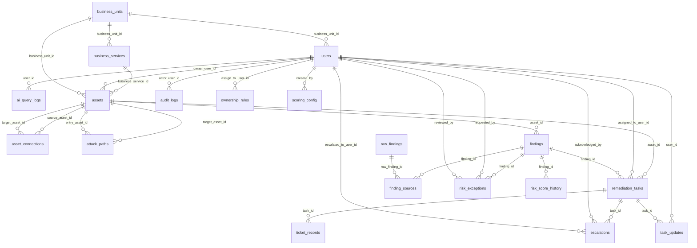

# Data Model

Generated from the SQLAlchemy models (`backend/app/models/*.py`) by `scripts/generate_reference_docs.py`. Every table also has `id` (UUID primary key), `created_at` and `updated_at` from `TimestampMixin`.

## Migrations

| Revision | Purpose |
|---|---|
| `0001_foundation` | Creates every table from the current metadata. |
| `0002_audit_chain_and_workflow` | Adds (only when missing) `audit_logs.sequence/prev_hash/row_hash` with a unique index, `raw_findings.error_message`, `findings.closed_at/reopened_count`, `remediation_tasks.assigned_group`, `escalations.acknowledged_at/acknowledged_by`; installs triggers that reject `UPDATE` and `DELETE` on `audit_logs` (SQLite and PostgreSQL). |

## Entity relationships

## Tables

### `ai_query_logs`

| Column | Type | Null | Key / index |
|---|---|---|---|
| `user_id` | UUID | no | FK → `users.id`, indexed |
| `question` | TEXT | no |  |
| `detected_intent` | VARCHAR(80) | no |  |
| `answer_summary` | TEXT | no |  |
| `used_llm` | BOOLEAN | no |  |

### `asset_connections`

| Column | Type | Null | Key / index |
|---|---|---|---|
| `source_asset_id` | UUID | no | FK → `assets.id`, indexed |
| `target_asset_id` | UUID | no | FK → `assets.id`, indexed |
| `connection_type` | VARCHAR(30) | no |  |
| `port_or_protocol` | VARCHAR(80) | yes |  |
| `notes` | TEXT | yes |  |

### `assets`

| Column | Type | Null | Key / index |
|---|---|---|---|
| `name` | VARCHAR(200) | no | indexed |
| `asset_type` | VARCHAR(40) | no |  |
| `hostname` | VARCHAR(255) | yes |  |
| `ip_address` | VARCHAR(45) | yes |  |
| `environment` | VARCHAR(20) | no |  |
| `business_unit_id` | UUID | yes | FK → `business_units.id`, indexed |
| `business_service_id` | UUID | yes | FK → `business_services.id` |
| `owner_user_id` | UUID | yes | FK → `users.id` |
| `criticality_tier` | INTEGER | no |  |
| `is_customer_facing` | BOOLEAN | no |  |
| `is_crown_jewel` | BOOLEAN | no |  |
| `has_sensitive_data` | BOOLEAN | no |  |
| `regulatory_tags` | JSON | no |  |
| `internet_exposed` | BOOLEAN | no |  |
| `os_or_platform` | VARCHAR(120) | yes |  |
| `status` | VARCHAR(30) | no |  |

### `attack_paths`

| Column | Type | Null | Key / index |
|---|---|---|---|
| `name` | VARCHAR(200) | no |  |
| `entry_asset_id` | UUID | no | FK → `assets.id` |
| `target_asset_id` | UUID | no | FK → `assets.id` |
| `path_asset_ids` | JSON | no |  |
| `path_finding_ids` | JSON | no |  |
| `path_risk_score` | FLOAT | no |  |
| `calculated_at` | DATETIME | no |  |

### `audit_logs`

| Column | Type | Null | Key / index |
|---|---|---|---|
| `actor_user_id` | UUID | yes | FK → `users.id` |
| `action` | VARCHAR(100) | no | indexed |
| `entity_type` | VARCHAR(80) | no |  |
| `entity_id` | UUID | yes |  |
| `old_value` | JSON | yes |  |
| `new_value` | JSON | yes |  |
| `ip_address` | VARCHAR(45) | yes |  |
| `sequence` | INTEGER | yes | unique, indexed |
| `prev_hash` | VARCHAR(64) | yes |  |
| `row_hash` | VARCHAR(64) | yes |  |

### `business_services`

| Column | Type | Null | Key / index |
|---|---|---|---|
| `name` | VARCHAR(120) | no |  |
| `business_unit_id` | UUID | no | FK → `business_units.id` |
| `description` | TEXT | yes |  |

### `business_units`

| Column | Type | Null | Key / index |
|---|---|---|---|
| `name` | VARCHAR(120) | no | unique |
| `head_user_id` | UUID | yes |  |

### `escalations`

| Column | Type | Null | Key / index |
|---|---|---|---|
| `task_id` | UUID | no | FK → `remediation_tasks.id`, indexed |
| `level` | INTEGER | no |  |
| `escalated_to_user_id` | UUID | yes | FK → `users.id` |
| `reason` | TEXT | no |  |
| `acknowledged` | BOOLEAN | no |  |
| `acknowledged_at` | DATETIME | yes |  |
| `acknowledged_by` | UUID | yes | FK → `users.id` |

### `finding_sources`

| Column | Type | Null | Key / index |
|---|---|---|---|
| `finding_id` | UUID | no | FK → `findings.id`, indexed |
| `raw_finding_id` | UUID | no | FK → `raw_findings.id`, indexed |
| `source_name` | VARCHAR(100) | no |  |

### `findings`

| Column | Type | Null | Key / index |
|---|---|---|---|
| `asset_id` | UUID | no | FK → `assets.id`, indexed |
| `vulnerability_id` | UUID | yes |  |
| `finding_type` | VARCHAR(40) | no |  |
| `title` | VARCHAR(300) | no |  |
| `description` | TEXT | yes |  |
| `severity` | VARCHAR(20) | no | indexed |
| `cvss_score` | FLOAT | yes |  |
| `sources` | JSON | no |  |
| `first_seen` | DATETIME | yes |  |
| `last_seen` | DATETIME | yes |  |
| `status` | VARCHAR(30) | no | indexed |
| `fingerprint` | VARCHAR(64) | no | unique, indexed |
| `risk_score` | FLOAT | no | indexed |
| `risk_band` | VARCHAR(20) | no |  |
| `risk_breakdown` | JSON | no |  |
| `closed_at` | DATETIME | yes |  |
| `reopened_count` | INTEGER | no |  |

### `import_batches`

| Column | Type | Null | Key / index |
|---|---|---|---|
| `source_name` | VARCHAR(100) | no |  |
| `file_name` | VARCHAR(255) | no |  |
| `total_records` | INTEGER | no |  |
| `success_count` | INTEGER | no |  |
| `failed_count` | INTEGER | no |  |
| `duplicate_count` | INTEGER | no |  |
| `status` | VARCHAR(30) | no |  |
| `errors` | JSON | no |  |
| `started_at` | DATETIME | yes |  |
| `finished_at` | DATETIME | yes |  |

### `ownership_rules`

| Column | Type | Null | Key / index |
|---|---|---|---|
| `priority_order` | INTEGER | no | indexed |
| `match_field` | VARCHAR(40) | no |  |
| `match_value` | VARCHAR(200) | no |  |
| `assign_to_user_id` | UUID | yes | FK → `users.id` |
| `assign_to_group` | VARCHAR(120) | yes |  |

### `raw_findings`

| Column | Type | Null | Key / index |
|---|---|---|---|
| `source_name` | VARCHAR(100) | no |  |
| `source_type` | VARCHAR(40) | no |  |
| `import_batch_id` | UUID | yes |  |
| `raw_payload` | JSON | no |  |
| `imported_at` | DATETIME | no |  |
| `status` | VARCHAR(20) | no |  |
| `error_message` | TEXT | yes |  |

### `remediation_tasks`

| Column | Type | Null | Key / index |
|---|---|---|---|
| `finding_id` | UUID | no | FK → `findings.id`, indexed |
| `asset_id` | UUID | no | FK → `assets.id` |
| `assigned_to_user_id` | UUID | yes | FK → `users.id` |
| `assigned_by_rule` | VARCHAR(120) | yes |  |
| `assigned_group` | VARCHAR(120) | yes |  |
| `status` | VARCHAR(30) | no |  |
| `priority` | VARCHAR(20) | no |  |
| `sla_due_date` | DATETIME | yes | indexed |
| `sla_category` | VARCHAR(30) | yes |  |
| `closed_at` | DATETIME | yes |  |
| `evidence_notes` | TEXT | yes |  |
| `ticket_ref` | VARCHAR(100) | yes |  |

### `risk_exceptions`

| Column | Type | Null | Key / index |
|---|---|---|---|
| `finding_id` | UUID | no | FK → `findings.id`, indexed |
| `requested_by` | UUID | no | FK → `users.id` |
| `justification` | TEXT | no |  |
| `compensating_controls` | TEXT | no |  |
| `exception_type` | VARCHAR(20) | no |  |
| `requested_expiry_date` | DATETIME | no |  |
| `status` | VARCHAR(20) | no |  |
| `reviewed_by` | UUID | yes | FK → `users.id` |
| `review_comment` | TEXT | yes |  |
| `approved_at` | DATETIME | yes |  |

### `risk_score_history`

| Column | Type | Null | Key / index |
|---|---|---|---|
| `finding_id` | UUID | no | FK → `findings.id`, indexed |
| `score` | FLOAT | no |  |
| `band` | VARCHAR(20) | no |  |
| `calculated_at` | DATETIME | no |  |
| `config_version` | INTEGER | no |  |

### `scoring_config`

| Column | Type | Null | Key / index |
|---|---|---|---|
| `version` | INTEGER | no | unique |
| `weights` | JSON | no |  |
| `band_thresholds` | JSON | no |  |
| `is_active` | BOOLEAN | no |  |
| `created_by` | UUID | yes | FK → `users.id` |

### `sla_policies`

| Column | Type | Null | Key / index |
|---|---|---|---|
| `risk_band` | VARCHAR(20) | no | unique |
| `sla_days` | INTEGER | no |  |
| `escalation_level_1_days` | INTEGER | no |  |
| `escalation_level_2_days` | INTEGER | no |  |

### `task_updates`

| Column | Type | Null | Key / index |
|---|---|---|---|
| `task_id` | UUID | no | FK → `remediation_tasks.id`, indexed |
| `user_id` | UUID | no | FK → `users.id` |
| `old_status` | VARCHAR(30) | yes |  |
| `new_status` | VARCHAR(30) | no |  |
| `comment` | TEXT | yes |  |

### `ticket_records`

| Column | Type | Null | Key / index |
|---|---|---|---|
| `task_id` | UUID | no | FK → `remediation_tasks.id`, indexed |
| `system` | VARCHAR(30) | no |  |
| `ticket_key` | VARCHAR(100) | no | unique |
| `status` | VARCHAR(30) | no |  |
| `payload` | JSON | no |  |

### `users`

| Column | Type | Null | Key / index |
|---|---|---|---|
| `email` | VARCHAR(320) | no | unique, indexed |
| `full_name` | VARCHAR(160) | no |  |
| `hashed_password` | VARCHAR(255) | no |  |
| `role` | VARCHAR(40) | no |  |
| `business_unit_id` | UUID | yes | FK → `business_units.id` |
| `is_active` | BOOLEAN | no |  |
| `mfa_enabled` | BOOLEAN | no |  |
| `mfa_secret` | VARCHAR(512) | yes |  |
| `failed_login_count` | INTEGER | no |  |
| `locked_until` | DATETIME | yes |  |
| `refresh_token_hash` | VARCHAR(64) | yes |  |

### `vulnerability_catalog`

| Column | Type | Null | Key / index |
|---|---|---|---|
| `cve_id` | VARCHAR(24) | no | unique, indexed |
| `title` | VARCHAR(300) | no |  |
| `description` | TEXT | yes |  |
| `cvss_base_score` | FLOAT | yes |  |
| `cvss_vector` | VARCHAR(160) | yes |  |
| `cwe` | VARCHAR(40) | yes |  |
| `published_date` | DATE | yes |  |
| `has_public_exploit` | BOOLEAN | no |  |
| `exploit_maturity` | VARCHAR(20) | no |  |
| `epss_score` | FLOAT | no |  |
| `in_kev_list` | BOOLEAN | no |  |
| `ransomware_used` | BOOLEAN | no |  |
| `actively_exploited` | BOOLEAN | no |  |

## Synthetic dataset → tables

| File (`backend/data/synthetic/`) | Loaded into |
|---|---|
| `business_units.json`, `business_services.json` | `business_units`, `business_services` |
| `assets.json` (300 assets; `owner_email` is the SC-6 ownership ground truth) | `assets` |
| `asset_connections.json` | `asset_connections` (attack-path graph edges) |
| `vulnerability_catalog.json`, `threat_intel_feed.json` (120 CVEs) | `vulnerability_catalog` |
| `scanner_export.csv`, `cspm_findings.json`, `pentest_report.json`, `container_k8s_findings.json`, `identity_findings.csv`, `easm_findings.json` | `import_batches`, `raw_findings`, `finding_sources`, `findings` |

Retention: raw rows (including failed rows) are kept for traceability and retry; audit rows are append-only; score history is kept per recalculation and drives trend analytics.
