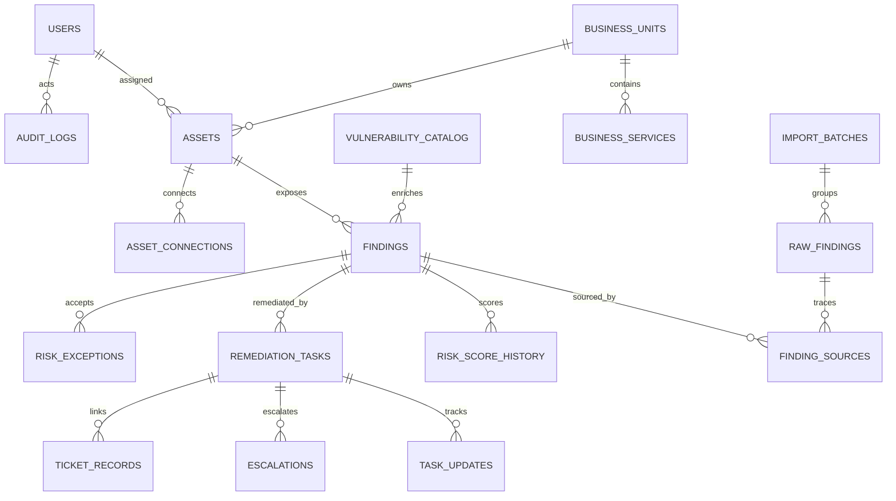

# Data Model

## Entity relationship diagram

## Dictionary

All entities use UUID primary keys and creation/update timestamps. The implementation uses PostgreSQL UUID and JSON types, with array-like fields represented as JSON for convenient SQLite-compatible service testing.

| Table | Purpose and main fields |
|---|---|
| `users` | Email, name, bcrypt hash, role, BU, active/MFA state, encrypted TOTP secret, failed-login lock and refresh hash |
| `business_units` | Five fictional banking functions and optional head user |
| `business_services` | Named services associated with a business unit |
| `assets` | Host/type/environment/BU/service/owner, tier, exposure, crown-jewel, data, tags, platform, status |
| `asset_connections` | Directed relationship type and protocol between assets |
| `vulnerability_catalog` | CVE metadata, CVSS, CWE, EPSS, KEV, exploit maturity, ransomware and active-use flags |
| `raw_findings` | Imported source name/type, batch ID, JSON payload, import time and processing status |
| `findings` | Normalized asset/CVE issue, source set, status, fingerprint, score/band/breakdown |
| `finding_sources` | Many-to-many trace from normalized finding to raw input |
| `risk_score_history` | Score, band, time and scoring config version |
| `scoring_config` | Versioned JSON weights and band thresholds |
| `attack_paths` | Entry/target, ordered asset/finding IDs and path risk |
| `remediation_tasks` | Finding, asset, owner, priority, SLA, state, evidence and simulated ticket ref |
| `task_updates` | Status transition, actor, comment and time |
| `sla_policies` | Risk-band target and escalation day thresholds |
| `escalations` | Task, escalation level, recipient, reason and acknowledgement |
| `risk_exceptions` | Request, controls, type, expiry, decision, reviewer and review comment |
| `ownership_rules` | Ordered match field/value and user/group assignment target |
| `ticket_records` | Simulated JIRA_SIM/SERVICENOW_SIM key, status and JSON payload |
| `audit_logs` | Actor, action, entity, old/new JSON values, IP and timestamp; application provides read-only access |
| `import_batches` | Source, filename, total/new/failed/duplicate counts and errors |
| `ai_query_logs` | User question, intent, summary and LLM-use flag |

Indexes support finding asset/status/fingerprint/risk and task due-date lookups, plus BU asset inventory and user/CVE search.
