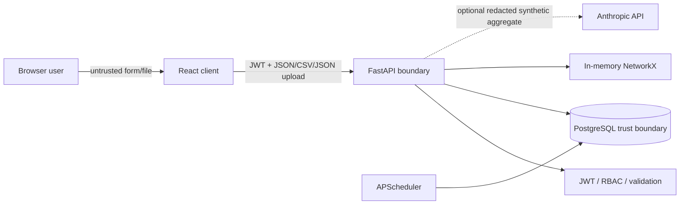

# Threat Model (STRIDE)

## Data-flow and boundaries

External users and uploaded files are untrusted. The API is the authorization boundary. PostgreSQL is a private Compose service. Optional Claude is an external processor and must receive only minimal synthetic data.

## STRIDE register

| Threat | STRIDE | Mitigation | Status |
|---|---|---|---|
| Stolen password reused by an attacker | Spoofing | bcrypt, lock after five failed attempts, short access-token life | Implemented; shared demo password is intentionally non-production |
| Forged or replayed refresh token | Spoofing / Repudiation | Signed JWT, stored one-use hash, rotation, logout revokes hash | Implemented |
| User changes a finding outside assigned role | Tampering / Elevation | JWT role dependencies, default-deny checks, owner checks on task updates | Partial; data-level BU scoping needs production policy design |
| Malformed CSV/JSON exhausts memory | Denial of service | 10 MB read cap, extension check, parser errors reported | Implemented; upstream proxy limits should also be set |
| Duplicate or altered source finding | Tampering | Raw payload retention, fingerprint, source provenance, audit events | Implemented |
| Import error reveals server internals | Information disclosure | Structured error response, no traceback returned | Implemented |
| Audit row altered by an application user | Tampering / Repudiation | No update/delete API; access limited to reads | Partial; database owner can still alter rows |
| Prompt injection asks for secrets | Elevation / Information disclosure | Intent parser, restrictive system prompt, no tools, aggregate synthetic context, response disclaimer | Implemented baseline; human review required |
| Exposed database volume | Information disclosure | Private Compose network, demo credentials, document production volume encryption | Demo only; production encryption is external |
| Insecure browser embedding | Elevation | CSP frame-ancestors, X-Frame-Options, nosniff, TLS profile | Implemented |
| API key committed to git | Information disclosure | Environment settings, `.env` ignore, gitleaks CI | Implemented |
| Token theft through browser storage | Spoofing | Access token only in module memory; no localStorage | Partial; refresh response should move to HttpOnly cookie in production |

## OWASP Top 10 mapping

| OWASP area | Design response |
|---|---|
| A01 Broken Access Control | Bearer JWT and role dependencies; task-owner validation; test negative cases |
| A02 Cryptographic Failures | bcrypt, Fernet MFA secret protection, optional TLS reverse proxy |
| A03 Injection | SQLAlchemy ORM parameters, JSON serialization, React text rendering |
| A04 Insecure Design | Threat model, explicit synthetic-only boundary, self-approval rejection |
| A05 Security Misconfiguration | Environment configuration, restrictive CORS, security headers, pinned dependencies |
| A06 Vulnerable Components | CI runs pip-audit and npm audit |
| A07 Authentication Failures | Lockout, short access token, refresh rotation, TOTP readiness |
| A08 Software/Data Integrity | Alembic, source trace, fixed seed, audit event history |
| A09 Logging/Monitoring Failures | Request IDs and append-oriented workflow audit records |
| A10 SSRF | No URL fetch, no live scanner integrations, no user-selected network target |
