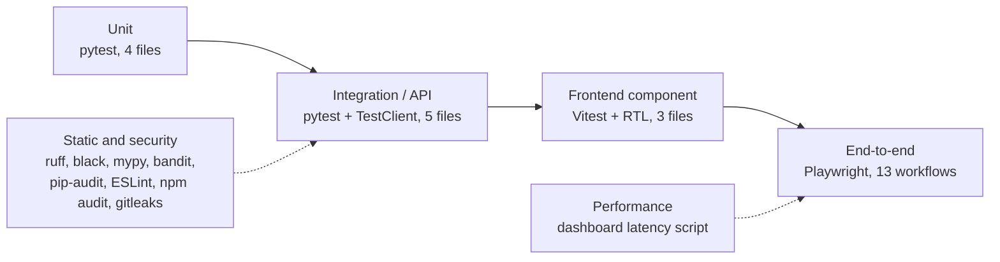
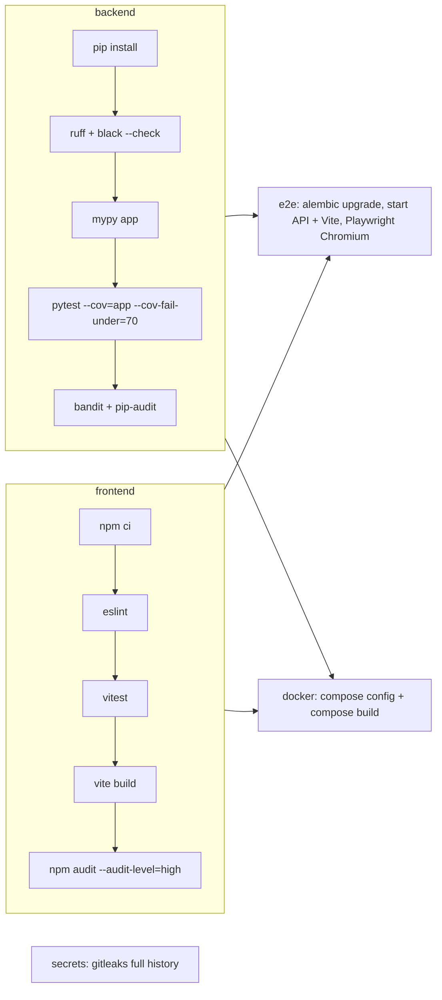

# Test Plan

| Item | Value |
|---|---|
| System under test | Intelligent Vulnerability Management & Risk Prioritization Platform (IVM) |
| Version | 0.1.0 (`backend/app/main.py`) |
| Data | Synthetic only — generator `backend/scripts/generate_synthetic_data.py`, seed 42 |
| Last full execution | 2026-11-07 (evidence in `docs/evidence/`, see `12_Test_Evidence.md`) |
| Related documents | `11_Test_Cases.md`, `12_Test_Evidence.md`, `13_Defect_Summary.md`, `20_Requirements_Traceability_Matrix.md` |

This platform is a capstone prototype. Passing this plan demonstrates that the specified use cases work on synthetic data; it does not certify production readiness.

## 1. Objectives

1. Show that each use case (UC-1..UC-14) and success criterion (SC-1..SC-12) is implemented and works end to end.
2. Prove the access-control model: 9 roles x 28 permissions, central default-deny, and row-level data scope (`backend/app/core/rbac.py`, `backend/app/core/deps.py`, `backend/app/core/scope.py`).
3. Show that the risk engine is bounded, explainable and configuration-driven, and that threat intelligence and attack paths change priority.
4. Keep defects from coming back by having a regression test for each one that can be automated (`13_Defect_Summary.md`).
5. Keep the code clean, typed and free of known-vulnerable dependencies.

## 2. Scope

### In scope

| Area | What is tested |
|---|---|
| Ingestion and normalization | Scanner, CSPM, pentest, container, identity and EASM sources; parsing; severity aliases; asset-key matching (hostnames, FQDNs, IPs, URLs); fingerprinting; duplicate correlation; survivorship; reopen on re-detection; failed-row retention and retry; threat-intel feed import |
| Risk engine | 8 factors with max points 25/15/10/10/15/10/5/10, bands 80/60/40, bounds, attack-path influence, rescoring after asset or threat changes |
| Attack paths | networkx route from an internet-exposed entry to a crown jewel; base vs final score; impact report; Cypher/GraphML export |
| Workflow | Ownership rules and fallbacks, reassignment, task lifecycle with evidence, SLA escalation levels from policy, acknowledgement, notifications, breach forecast, exceptions (request, separate approver, expiry, review pack), simulated Jira/ServiceNow tickets with an HMAC webhook |
| Reporting and AI | Role dashboards, success-criteria report, executive report (JSON/HTML), automation impact, ownership accuracy, offline assistant intents, entities, follow-ups and source attribution |
| Security | Authentication, lockout, MFA (TOTP), password policy, token refresh, RBAC matrix, data scope, CSV formula injection, input validation, audit hash chain and append-only triggers, SECRET_KEY validation |
| Frontend | Login screen, permission-driven navigation and route guards, API client token refresh and paging |
| Non-functional | Dashboard latency, static analysis, dependency audit, basic accessibility through role/label-based selectors |

### Out of scope

Real scanners, patch deployment, production SOC integrations, commercial ticketing systems, live bank systems or real data, load testing at production volumes, penetration testing by a third party, and browsers other than Chromium.

## 3. Test levels and strategy



| Level | Tooling | Location | Strategy |
|---|---|---|---|
| Unit | pytest 9, parametrisation | `backend/tests/unit/` | Pure functions: `risk_engine.score_finding`, `normalization`, `forecasting`, `ingestion.parse_upload`, assistant finding context. Boundary and alias tables are parametrised. |
| Integration / API | pytest + FastAPI `TestClient`, in-memory SQLite (`StaticPool`) | `backend/tests/integration/` | Each test builds an isolated database (`conftest.py`). The `world` fixture creates two business units, one user per role (scoped to unit A) and seeded findings, tasks and exceptions, so scope leaks show up. `test_seeded_smoke.py` loads the full demo seed once per module. |
| RBAC matrix | pytest parametrised by role | `test_role_matrix.py` | 24 guarded endpoints x 9 roles: each call must return 200 if `ROLE_PERMISSIONS` grants the permission and 403 if not; anonymous calls must return 401. |
| Frontend | Vitest 5 + React Testing Library, jsdom | `frontend/src/**/*.test.ts(x)` | The shell, navigation and guards are driven by permissions; the API client's single-flight refresh, `X-Total-Count` paging and query strings are tested with a mocked `fetch`. |
| End-to-end | Playwright (Chromium, 1 worker, no retries) | `e2e/workflows.spec.ts`, `playwright.config.ts` | Role-based journeys against the running API and web app with the seeded demo users (`user1`..`user12@demo.bank`). |
| Security | bandit, pip-audit, npm audit, gitleaks, tests for auth/scope/injection | CI and `scripts/collect_evidence.sh` | Static analysis (SAST) and dependency scanning on every run; security behaviour is tested at the integration level. |
| Performance | `backend/scripts/measure_dashboard_latency.py` | — | 10 sequential `GET /api/v1/dashboards/executive` calls against the seeded demo; the script fails if p95 >= 3 s. It measures API response time, not browser render time. |
| Accessibility | Playwright locators by role and label; manual review | `e2e/workflows.spec.ts` | Every E2E step finds elements by accessible name (`getByRole`, `getByLabel`), so missing labels fail the test. Keyboard use is exercised in part (Escape closes the task drawer). No automated contrast or axe audit is run; this is a known gap (section 10). |

## 4. Environments

| Environment | Database | How it is started | Used for |
|---|---|---|---|
| Unit/integration | In-memory SQLite per test (`sqlite://`, `StaticPool`) | `pytest` | All backend tests |
| Local demo (macOS) | File SQLite `ivm_local_demo.sqlite`, seeded at API start-up | `scripts/dev.sh` (uvicorn :8000, Vite :5173) | E2E, latency, manual exploration |
| CI (GitHub Actions) | SQLite (`sqlite:///./ivm_ci.sqlite`) after `alembic upgrade head` | `.github/workflows/ci.yml` job `e2e` | Playwright in CI |
| Containerised | PostgreSQL 15 (`postgres:15-alpine`) | `docker compose up --build` (optional `tls` profile) | Production-like runtime; CI job `docker` runs `docker compose config` and `docker compose build` |
| Kubernetes | PostgreSQL StatefulSet | `deploy/k8s/*.yaml` | Reference manifests only |

Limits that apply to these environments:

- No automated test runs against PostgreSQL. Both CI and local runs use SQLite. PostgreSQL-specific code (the advisory lock for audit appends, the PostgreSQL trigger variant in migration `0002`, and `pg_dump` in `backend/scripts/backup.sh`) has been reviewed but not executed. Docker is not installed on the development machine.
- The Kubernetes manifests have been parsed as YAML but never applied to a cluster.
- The optional Claude rephrasing path in `backend/app/services/ai_assistant.py` is not tested because no API key is configured. All assistant tests use the deterministic offline engine.

## 5. Tools

| Purpose | Tool (version as recorded in evidence) |
|---|---|
| Backend tests and coverage | pytest 9.0.3, pytest-cov 6.0.0, Python 3.12.16 |
| Lint / format / types | ruff, black, mypy |
| Backend SAST / dependencies | bandit, pip-audit |
| Frontend tests | Vitest 5.1.0, React Testing Library |
| Frontend lint / build | ESLint, `tsc -b && vite build` (Vite 6.4.5) |
| Frontend dependencies | `npm audit --audit-level=high` |
| End-to-end | `@playwright/test` 1.64.1, Chromium |
| Secrets scanning | gitleaks (`.gitleaks.toml`, CI only) |
| Evidence collection | `scripts/collect_evidence.sh [--with-e2e]` |

## 6. Entry and exit criteria

### Entry

- Dependencies are installed (`.venv`, `frontend/node_modules`, root Playwright).
- Synthetic data exists in `backend/data/synthetic/` (seed 42).
- For E2E and latency runs: `GET /api/v1/health` responds and the demo seed has loaded (start with `LOGIN_RATE_LIMIT=100 ./scripts/dev.sh` so repeated E2E logins are not throttled).

### Exit

| Criterion | Target | Achieved 2026-11-07 |
|---|---|---|
| Backend tests | 100% pass | 113 passed, 0 failed, 0 skipped |
| Backend line coverage (whole `app` package) | >= 70% (enforced with `--cov-fail-under=70`) | 85% (`TOTAL 3668 538 85%`; "Total coverage: 85.33%") |
| Frontend tests | 100% pass | 12 passed (3 files) |
| E2E workflows | 100% pass | 13 passed |
| ruff / black / mypy / ESLint | No findings | Clean |
| bandit | No unreviewed issues | 0 issues (3 findings suppressed with `#nosec`, as reported by bandit) |
| pip-audit / npm audit (high) | No known vulnerabilities | None found / 0 vulnerabilities |
| Dashboard latency | p95 < 3 s | mean 0.500 s, p95 0.514 s |
| Success criteria report | SC-1..SC-12 met on a fresh seed | 12 of 12 `passed: true` |
| Defects | No open Critical/High defects | 34 recorded, all Closed |

## 7. CI pipeline

`.github/workflows/ci.yml` runs on pushes to `main`/`develop` and on pull requests, with `permissions: contents: read`.



Any failing stage fails the build, and the coverage gate fails `pytest` itself. The CI definition has not yet been seen running on GitHub, because the local repository has no commits or remote (see `20_Requirements_Traceability_Matrix.md`, section 11 practices). Local results come from `scripts/collect_evidence.sh`, which runs the same commands.

## 8. Test data

- All records are fictional. The generator uses seed 42: 300 assets, 2,500 raw finding rows across scanner, CSPM, pentest, container and identity files, plus EASM and threat-intel samples.
- The test fixtures in `backend/tests/conftest.py` build minimal records and use the `*.bank.local` and `@test.local` domains only.
- Malicious-looking inputs (`=HYPERLINK(...)` and `+cmd|...` in the fixtures) are deliberate, so the CSV-injection controls can be tested.
- No real credentials appear anywhere. The demo password `DemoPass!234` exists only in the synthetic seed.

## 9. Roles and responsibilities

| Role | Responsibility |
|---|---|
| Developer (capstone candidate) | Writes unit/integration/E2E tests alongside each feature, runs `collect_evidence.sh` before each submission, logs and fixes defects |
| Reviewer / assessor | Reviews this plan, the case catalogue and the evidence; re-runs the suite if needed |
| CI | Enforces lint, types, the coverage gate, security scans, E2E and the container build on every push and PR |

## 10. Risks and mitigations

| Risk | Impact | Mitigation / status |
|---|---|---|
| PostgreSQL behaviour differs from SQLite (timezones, triggers, advisory locks) | Defects that appear only in production | Timestamps are normalised through `app/core/timeutil.py` (defects DEF-005/006); triggers exist for both engines in migration `0002`. **Open:** add a PostgreSQL service to the CI test job. |
| Docker and Kubernetes not run locally | Container start-up defects go unnoticed | CI `docker` job; the non-root image and `.dockerignore` were added (DEF-033). **Open:** run compose locally or in CI with health checks. |
| Coverage is uneven between modules | Untested branches in less-used routes | Whole-package gate at 70%. The lowest modules are `routes/users.py` 41%, `routes/risk.py` 44% and `routes/imports.py` 66% (from `backend-tests.txt`). |
| E2E tests depend on seeded data and the login rate limit | Flaky runs | Seed is deterministic; `LOGIN_RATE_LIMIT=100` for E2E; locators wait on headings and tables (DEF-018). |
| Accessibility checked only through selectors | Contrast or focus problems missed | Manual review. **Open:** add an axe-core scan to the E2E suite. |
| Latency measured with 10 sequential samples on 300 assets | Says little about concurrent load | Treat as a functional check against the 3 s NFR, not a load test. |
| Optional LLM path untested | Behaviour with a real model unknown | The offline engine is the default and is fully tested; the LLM only rephrases already-computed answers. |

## 11. Schedule

| Date | Activity | Outcome |
|---|---|---|
| 2026-11-03 | First verification pass (targeted coverage, 5 E2E flows) | Superseded |
| 2026-11-06 | Pass 1: defect sweep, role matrix, scope tests, CI | 79 backend, 12 frontend, 9 E2E passing; defects DEF-001..DEF-018 fixed |
| 2026-11-07 | Pass 2: specification gap closure (ingestion, scoring, MFA, audit chain, reports) | 113 backend, 12 frontend, 13 E2E passing; DEF-019..DEF-034 fixed; evidence collected |
| Before submission | Re-run `scripts/collect_evidence.sh --with-e2e` on the final build | Refresh `docs/evidence/` |

## 12. How to run

```bash
# Backend (from backend/)
../.venv/bin/python -m pytest -v --cov=app --cov-report=term --cov-fail-under=70

# Frontend (from frontend/)
npm test && npm run lint && npm run build && npm audit --audit-level=high

# End-to-end (stack must be running)
LOGIN_RATE_LIMIT=100 ./scripts/dev.sh            # in one terminal
PLAYWRIGHT_BASE_URL=http://127.0.0.1:5173 npx playwright test

# Everything, writing docs/evidence/
scripts/collect_evidence.sh --with-e2e
```
