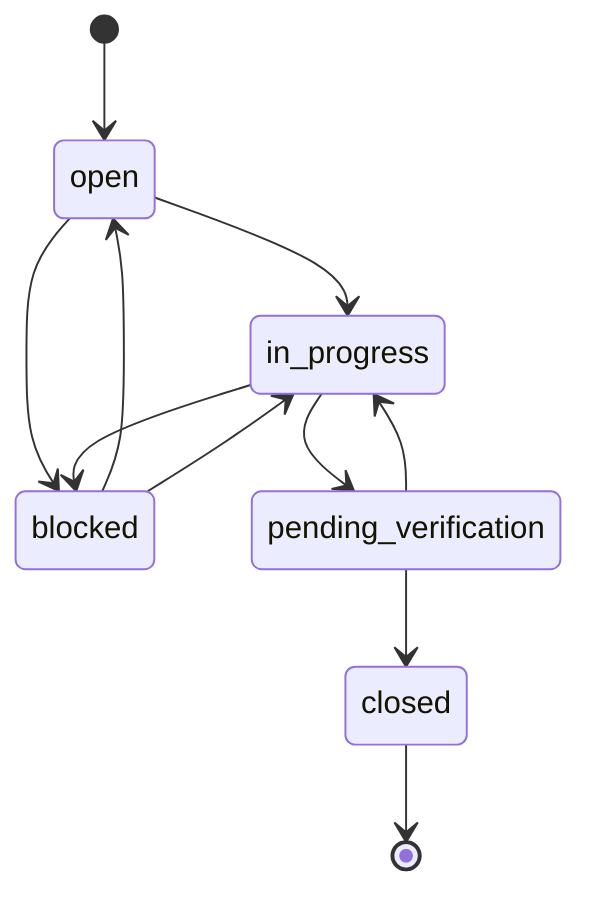

# User Manual

Intelligent Vulnerability Management & Risk Prioritization Platform (IVM) — academic capstone prototype.

This manual is task-oriented: find your role in section 2, then follow the task sections that apply to you. Every record in the application is synthetic. The platform does not scan networks, connect to bank systems or deploy patches.

| Section | Content |
|---|---|
| 1 | Signing in, MFA step, session behaviour |
| 2 | Roles, demo accounts and what each role sees |
| 3 | Layout: navigation, global search, notifications, account menu |
| 4 | Overview dashboards |
| 5 | Findings: search, filter, sort, paging, CSV |
| 6 | Finding detail: explainable score, threat intelligence, attack-path context, source records |
| 7 | Asset inventory: browse, register, edit criticality |
| 8 | Attack paths |
| 9 | Remediation queue and task drawer |
| 10 | Risk exceptions |
| 11 | Data imports |
| 12 | AI assistant |
| 13 | Reports & insights |
| 14 | Notifications bell |
| 15 | My account: MFA and password |
| 16 | Audit trail |
| 17 | Administration (summary; see the Admin Guide) |
| 18 | Messages you may see and what they mean |

---

## 1. Signing in

1. Open the web app:
   - local development (`./scripts/dev.sh` or the Windows steps in `README.md`): `http://127.0.0.1:5173`
   - Docker Compose: `http://localhost:8080` (or `https://localhost:8443` with the TLS profile)
2. The sign-in form is prefilled with `user2@demo.bank` and the demo password `DemoPass!234`. Change the **Email address** to switch role (see section 2).
3. Select **Continue**.
4. **MFA step.** If the account has multi-factor authentication turned on, the form stays open and an **Authenticator code** field appears below the password. Enter the 6-digit code from your authenticator app and select **Continue** again. A wrong code shows *Invalid MFA code*. Changing the email address hides the code field again.

Sign-in behaviour (implemented in `backend/app/api/v1/routes/auth.py`):

| Situation | What you see |
|---|---|
| Wrong email or password, unknown email, deactivated account, or locked account | *Email or password is incorrect* (the message is deliberately the same in every case) |
| Five consecutive failures | The account is locked for 15 minutes. An administrator can clear the lock by resetting the password. |
| More than 10 sign-in attempts per minute from one address (default) | *Rate limit exceeded* — wait one minute |
| `MFA_REQUIRED=true` and you are a Platform Administrator, Security Architect or Vulnerability Manager without MFA | *MFA enrollment is required for this role; ask an administrator* |

**Session.** The access token lasts 15 minutes and is renewed automatically in the background while you work, so you are not signed out during normal use. Reloading the page keeps you signed in (the session is held in the browser tab's session storage and ends when the tab is closed). If renewal fails you return to the sign-in page with the banner *Your session expired. Please sign in again.*

**Signing out / switching role.** Select your name at the bottom of the left sidebar. This revokes your refresh token on the server and returns you to the sign-in form, where you can enter another demo account.

---

## 2. Roles and demo accounts

All accounts use the synthetic password `DemoPass!234`.

| Account | Role | Business unit (seed) | Data scope |
|---|---|---|---|
| `user1@demo.bank` | Platform Administrator | Retail Banking | Whole portfolio |
| `user2@demo.bank`, `user3@demo.bank` | Security Analyst | Corporate Banking / Treasury | Whole portfolio |
| `user4@demo.bank` | Vulnerability Manager | Cards and Payments | Whole portfolio |
| `user5@demo.bank` | Auditor | Digital Channels | Whole portfolio (read-only) |
| `user6@demo.bank` | Security Architect | Retail Banking | Assets in own business unit plus assets they own |
| `user7@demo.bank` | System Administrator | Corporate Banking | Only assets that carry a task assigned to them |
| `user8@demo.bank`–`user10@demo.bank` | IT Asset Owner | Treasury / Cards and Payments / Digital Channels | Assets they own plus assets in their business unit |
| `user11@demo.bank` | Executive / CISO | Retail Banking | Whole portfolio (aggregate views) |
| `user12@demo.bank` | Business Unit Manager | Corporate Banking | Assets in their business unit |

The scope column is the single rule set in `backend/app/core/scope.py`. The same rule applies to lists, dashboards, exports and the AI assistant, so a user never sees different numbers on different screens.

### 2.1 Menu entries by role

The sidebar shows only the pages your permissions allow (`frontend/src/access.ts`, mirroring `backend/app/core/rbac.py`). Opening a hidden page by URL returns you to the Overview.

| Page | Admin | Analyst | Vuln. Manager | Architect | Asset Owner | Sys. Admin | BU Manager | CISO | Auditor |
|---|---|---|---|---|---|---|---|---|---|
| Overview | Executive | Analyst | Manager | Analyst | Manager | Manager | Manager | Executive | Auditor |
| Findings | Yes | Yes | Yes | Yes | Yes | — | Yes | — | — |
| Asset inventory | Yes (edit) | Yes | Yes (edit) | Yes | Yes | Yes | Yes | — | — |
| Attack paths | Yes (recalculate) | Yes | Yes (recalculate) | Yes (recalculate) | — | — | — | — | — |
| Remediation | All tasks (update, reassign) | All tasks (read) | All tasks (update, reassign) | — | My tasks | My tasks | BU tasks (read) | — | — |
| Risk exceptions | Request | Request | Request, approve temporary | Request, approve all | Request | — | Read | — | Read |
| Data imports | Yes | Yes | Yes | — | — | — | — | — | — |
| AI assistant | Yes | Yes | Yes | Yes | — | — | — | Briefing on dashboard only | — |
| Reports & insights | Yes | Yes | Yes | Yes | Yes | Yes | Yes | Yes | Yes |
| Audit trail | Yes | Yes | — | Yes | — | — | — | — | Yes |
| Administration | Full | — | Read + scheduler + rescore | — | — | — | — | — | — |

Every role also has **My account** (avatar, top right) and the **notifications bell**.

### 2.2 Typical tasks by role

| Role | Start here | Typical tasks (sections) |
|---|---|---|
| Security Analyst | Overview → Findings | Import source files (11), triage findings (5, 6), inspect attack paths (8), ask the assistant (12), request exceptions (10) |
| Vulnerability Manager | Overview → Remediation | Run scheduler jobs and review escalations (17), reassign tasks and raise tickets (9), approve temporary exceptions (10), edit asset criticality (7), rescore (17) |
| IT Asset Owner | Remediation (*My remediation tasks*) | Move tasks through the workflow, add evidence, close (9); raise tickets; request exceptions (10) |
| System Administrator | Remediation (*My remediation tasks*) | Same as asset owner for tasks reassigned to them. In the seed, user7 owns no assets, so the queue is empty until a manager reassigns a task (section 9.4). |
| Security Architect | Risk exceptions | Approve temporary and long-term exceptions in scope (10); review attack paths (8); recalculate paths |
| Business Unit Manager | Overview (manager view) | Monitor the unit's tasks, overdue work and escalations; read exceptions; acknowledge escalations in the bell (14) |
| Executive / CISO | Overview (executive view) → Reports & insights | Read portfolio KPIs, heatmap, trend; generate the AI briefing; download the executive report (13) |
| Auditor | Audit trail | Filter and export events, verify the hash chain (16), download exception review packs (10) |
| Platform Administrator | Administration | Users and roles, scoring weights, SLA policy, ownership rules (Admin Guide); register assets (7) |

---

## 3. Screen layout

- **Left sidebar** — brand, the *Northstar Bank · Synthetic workspace* label, your menu entries, an *API connected* indicator and your name/role (select it to sign out).
- **Top bar** — breadcrumb (*Security / page name*); **Search findings…** box (roles with finding access) — type a term and press Enter to open the Findings page filtered by that term; the **notifications bell**; the *DEMO ENVIRONMENT* badge; a **?** icon that opens the API documentation (Swagger) in a new tab; and your avatar, which opens **My account**.
- **Skip to main content** link — the first Tab stop on every page, for keyboard users.
- Tables use real `<table>` markup with sortable column buttons that announce their sort direction to screen readers; form controls carry labels.

---

## 4. Overview dashboards

The Overview page loads the dashboard that matches your role (`frontend/src/pages/Dashboard.tsx`, `GET /api/v1/dashboards/{view}`). The header shows today's date and the view name; executive and analyst views offer **Executive report** (HTML download) and roles with audit access get **Download audit CSV**.

All views share four KPI tiles and two panels:

| Element | Meaning |
|---|---|
| Open findings | Open findings on assets in your scope, and how many assets that covers |
| Critical risk | Findings in the critical band, with the number rated high |
| SLA compliance | Share of tasks closed or still open within SLA; overdue count |
| Triage effort saved (executive/analyst/auditor) | Estimated analyst hours saved by de-duplication, under the stated six-minutes-per-duplicate-row assumption; shows raw rows → distinct findings |
| Mean time to remediate (manager view) | MTTR for critical tasks closed so far |
| Risk score trend | Weekly average risk score; choose the window with **Trend window** |
| Open findings by risk band | Distribution; roles with finding access can click a band to open the filtered Findings list |

View-specific sections:

| View | Who | Extra sections |
|---|---|---|
| Executive | CISO, Platform Admin | Risk by business unit; most exposed crown-jewel assets; risk reduction %; high-risk internet-facing assets; routes to crown jewels; **AI briefing → Generate briefing** (roles with the executive-summary permission); exceptions expiring in 30 days; overdue by owner and SLA category; heatmap by business service |
| Analyst | Analyst, Architect | Open findings by source; recent import batch quality; assets with the highest risk |
| Manager | Vuln. Manager, Asset Owner, Sys. Admin, BU Manager | Tasks by status; open-task age; overdue by owner; open escalations |
| Auditor | Auditor | Recent audit events; exception register by status |

All views except the auditor view end with **Highest priority open findings** (top five) and a note explaining the effort-saved assumption.

---

## 5. Findings (risk register)

*Roles: Admin, Analyst, Vulnerability Manager, Architect, Asset Owner, BU Manager.*

Open **Findings** in the sidebar. The page lists correlated findings, ranked by contextual risk score, 50 per page, all filtering and sorting done on the server.

| Control | How to use it |
|---|---|
| **Search findings…** | Matches finding text; results update shortly after you stop typing. The top-bar search lands here too. |
| **Risk band** | All, critical, high, medium, low |
| **Status** | All, open, in remediation, risk accepted, closed |
| Column headers **Finding**, **Severity**, **Risk score**, **Status** | Select once to sort descending, again to sort ascending. The default is risk score, highest first. |
| Pager | *1–50 of N*, previous / next page buttons, *Page x / y* |
| **Export CSV** | Downloads `ivm-findings.csv` with the current search, filters and sort. Cells that begin with `=`, `+`, `-` or `@` are neutralised so the file cannot run spreadsheet formulas. |
| **Import findings ＋** | Shown to roles that can import; opens Data imports |

Filters, sort and page are kept in the URL, so you can bookmark or share a filtered view (for example `/findings?band=critical&status=open`).

Each row shows the finding title (link), short finding and asset ids, the scanner **severity**, the contextual **risk score** with a bar, up to two **sources**, and the **status**. A finding whose risk band differs from its scanner severity is expected: the score adds business and threat context (section 6).

---

## 6. Finding detail

Select a finding title or the → arrow. The page header shows the title, scanner severity, status and asset name. **← Back to findings** returns to the list.

### 6.1 Explainable risk (left panel)

The large number is the contextual risk score out of 100 with its band badge (critical ≥ 80, high ≥ 60, medium ≥ 40, otherwise low). Below it, every factor is listed with points earned out of its maximum, a bar scaled to that maximum, and a plain-language reason. Factors are sorted by points earned.

| Factor (default max points) | What earns points |
|---|---|
| CVSS technical severity (25) | CVSS base score / 10 × 25 |
| Asset criticality (15) | Tier 1 = 15 … tier 5 = 2, plus crown jewel (+3) and customer-facing (+2), capped |
| Internet exposure (10) | Directly internet-exposed = 10; one hop from an exposed asset = 6 |
| Exploitability (10) | Exploit maturity (PoC 4, functional 7, weaponised 10) or EPSS × 10, whichever is higher |
| Threat intelligence (15) | CISA KEV (+8), actively exploited (+4), ransomware use (+3) |
| Data sensitivity (10) | Asset holds sensitive data |
| Regulatory impact (5) | PCI-DSS or SOX tag = 5; any other regulatory tag = 3 |
| Attack-path influence (10) | Finding lies on a modelled route to a crown jewel; scaled by the path's risk |

The maxima are configurable by the Platform Administrator (they must total 100); the panel always shows the active values. Source: `backend/app/services/risk_engine.py`.

### 6.2 Right-hand panels

| Panel | Content and actions |
|---|---|
| **Finding context** | Description, CVSS, source tools, linked asset (link to the asset profile if you can read assets). **Triage status** select (Admin, Analyst, Vuln. Manager): open, in remediation, risk accepted, closed. **Explain with AI** (roles with assistant access) opens the assistant and asks it to explain this finding. **Request exception** (roles that may request, finding not closed) opens the exception form with the finding preselected. |
| **Threat intelligence** | For CVE findings: CVE id, tags for *CISA KEV*, *Actively exploited*, *Ransomware*, exploit maturity, EPSS %, CVSS. Configuration, identity, pentest and EASM issues show that they are scored without CVE threat signals. |
| **Attack path context** | Shown when the finding is on a modelled path: the score *before → after* path context, how many routes it sits on, how many attack-path points it gained, and up to four route names with their path risk. |
| **Remediation** | Task status, SLA due date, assigned group, ticket reference and **Open task →** (opens the task drawer, section 9.3). Tasks are created automatically for high and critical findings. |
| **Source records · survivorship** | *N observation(s) from M source(s)*, first seen / last seen, how many times the finding was reopened, and the survivorship rule (highest severity and CVSS, most specific description). Expand each source record to see the original raw row as JSON. |
| **History** | The last eight score recalculations with date, band and score. |

---

## 7. Asset inventory

*Read: all roles except CISO and Auditor. Register and edit: Platform Administrator and Vulnerability Manager.*

### 7.1 Browse

Open **Asset inventory**. Assets are shown as cards, 30 per page, each with a posture badge (critical for crown jewels, high for internet-exposed, medium for tiers 1–2, otherwise low), name, hostname, environment, tier, and tags for *Internet exposed*, *Crown jewel* and *Sensitive data*.

Filters: **Search name or hostname…**, **Environment** (prod, uat, dev), **Exposure** (internet exposed / internal only), **Crown jewel**, **Criticality tier** (1–5) and **Sort assets** (most critical first, name A–Z / Z–A, environment, type). **Export CSV** downloads `ivm-assets.csv` with the current filters.

Select an asset to open its **profile**: business context (tier, type, business unit and service, owner, internet exposure, customer facing, crown jewel, sensitive data, regulatory tags, open findings / maximum risk), **Connections** (inbound ← and outbound → links with type and port; peers outside your scope are shown as *Outside your scope*) and **Findings on this asset**.

### 7.2 Register an asset (UC-1)

1. On Asset inventory select **Register asset ＋**.
2. Complete **Name** (required), **Hostname**, **IP address**, **Type**, **Environment** (prod, uat, dev, test, dr), **Business unit**, **Business service** (filtered to the chosen unit), **Owner**, **Criticality tier (1 = most critical)** and **Regulatory tags (comma separated)**.
3. Under **Criticality intelligence** tick any of **Internet exposed**, **Customer facing**, **Crown jewel**, **Holds sensitive data**.
4. Select **Register asset**. The new profile opens. The change is written to the audit trail.

### 7.3 Edit criticality, ownership and inventory (UC-2)

1. Open the asset profile and select **Edit asset**.
2. Change any field, including **Lifecycle status**.
3. Select **Save changes**. The confirmation states how many open findings were rescored, for example *Saved. 4 open finding(s) were rescored with the new context.* Changes to criticality, exposure, sensitivity or regulatory tags take effect on those findings immediately.

---

## 8. Attack paths

*Roles: Admin, Analyst, Vulnerability Manager, Architect. Recalculate: Admin, Vulnerability Manager, Architect.*

Open **Attack paths**. The platform models routes from internet-exposed assets to crown-jewel or sensitive-data assets over recorded asset connections (up to five hops; each hop must carry an open finding with CVSS ≥ 4). Source: `backend/app/services/attack_path.py`.

- **Priority routes** (right) lists the modelled paths (the first 25 are shown) with path score, number of asset hops, linked findings and a band badge. Use **Before feedback / After feedback** to switch the displayed scores between the base score and the score after attack-path influence.
- Select a route to show it on the left as an ordered chain: **Entry point**, **Hop n**, **Crown jewel target**, each with its open-finding count and worst finding. Asset names link to their profiles.
- **Before path context → After path context** compares the average risk of the route's findings without and with the attack-path factor, and states how many of the 10 attack-path points findings on the route can gain.
- **Recalculate paths** rebuilds the model from current assets, connections and findings, then rescores affected findings. The confirmation reads *Recalculated N paths.*

If you see *No attack paths are modeled for assets in your scope*, your scope contains no complete route; ask a manager to recalculate after imports or asset changes.

---

## 9. Remediation

*Roles: Admin, Analyst (read), Vulnerability Manager, Asset Owner, System Administrator, BU Manager (read).*

### 9.1 The queue

Open **Remediation**. Owners and system administrators see **My remediation tasks** (only tasks assigned to them); other roles see **Remediation tasks** for their scope. The description line shows the role you are signed in as.

| Control / column | Meaning |
|---|---|
| **Task status filter**, **Priority filter**, **Overdue only** | Server-side filters; the counter shows *N actions* |
| **SLA report CSV** | Downloads `ivm-sla-report.csv` with the current filters |
| Task / finding | Select **Finding xxxxxxxx** to open the task drawer; the small line shows task id, group and ticket key |
| Priority | Task priority (the finding's band when the task was created) |
| SLA due | Due date; *overdue* in red once passed |
| Breach risk | Predicted probability of missing the SLA, or *Breached* (section 9.5) |
| Status | Current status |
| Evidence | *Added* or *Pending* |
| Update | Status select (only for roles that can update) |

### 9.2 Update a task and close it with evidence (UC-9)

Tasks follow a fixed workflow, enforced by the server (`backend/app/api/v1/routes/tasks.py`):

1. (Optional) type a note in **Comment for the next status change**.
2. To close, first type the remediation evidence in **Evidence notes (required to close)**. The *Close* option stays disabled until evidence is entered.
3. In the task's **Update** select choose the next status. Move **Open → In progress → Verify → Close (evidence required)**.
4. The row updates in place. The comment, the status change and whether evidence was attached are recorded on the task timeline and in the audit trail. Closing the task also closes the finding; moving to in progress or verify sets the finding to *in remediation*.

The select lists every status, but only the transitions in the diagram are accepted. Choosing another one (for example *Close* directly from *Open*) shows *Invalid task transition: open -> closed*. Owners can update only tasks assigned to them; the Vulnerability Manager and Platform Administrator can update any task in scope.

### 9.3 The task drawer

Select **Finding xxxxxxxx** in a row, or **Open task →** on a finding. The drawer opens on the right; close it with **×**, **Escape**, or by clicking outside it.

| Section | Content |
|---|---|
| Header | Finding title, asset, priority, status, due date; **Open finding (risk n) →** |
| Ownership | Owner email, group and **Assigned by** (the ownership rule, *asset owner*, *business unit manager fallback* or *manual override*) |
| Reassign (Vuln. Manager, Admin) | Choose **New owner** and/or **Group**, enter a **Reason (required)** of at least 3 characters, select **Reassign**. The change is audited as *ownership reassigned* and appears on the timeline. |
| SLA breach risk | Probability and level, with the factors that produced it |
| Ticketing | Existing tickets (system, key, status). **Create Jira ticket** / **Create ServiceNow incident** create a simulated ticket (`JIRA_SIM` key `IVM-…`, `SERVICENOW_SIM` key `INC…`). Only one ticket per system per task is allowed. |
| Escalations | Level, recipient and whether acknowledged |
| Timeline | Every status change and reassignment with user, time and comment |

When an external ticket moves to *in progress* or *resolved* (simulated transition or signed webhook), the task moves to *in progress* or *pending verification*. A resolved ticket never closes the task: closure still requires evidence in IVM.

### 9.4 Reassign work to a system administrator

The seed assigns every asset to an IT Asset Owner (user8–user10). To show the System Administrator queue, sign in as `user4@demo.bank`, open a task drawer, choose *Demo System Administrator 7* as **New owner**, give a reason and select **Reassign**. `user7@demo.bank` then sees that task and its asset.

### 9.5 Breach risk

The breach probability comes from `backend/app/services/forecasting.py`: it learns typical time-to-close per risk band and each owner's on-time rate from closed tasks, then combines them with the time left and the current status. The drawer lists the factors used, so the number is explainable. It is a planning aid, not a guarantee.

---

## 10. Risk exceptions

*Read: Admin, Analyst, Vuln. Manager, Architect, Asset Owner, BU Manager, Auditor. Request: Admin, Analyst, Vuln. Manager, Architect, Asset Owner. Approve/reject/revoke: Vuln. Manager (temporary only) and Security Architect (temporary and long-term).*

### 10.1 Request an exception (UC-11)

1. Open **Risk exceptions** (or select **Request exception** on a finding, which preselects it).
2. In **Request an exception** narrow the list with **Find a finding** and choose the **Finding** (any finding that is not closed).
3. Choose **Exception type**: *Temporary (up to 90 days)* or *Long-term (up to 365 days, architect approval)*.
4. Pick an **Expiry date**; the date picker allows only dates inside the limit for the type.
5. Enter a **Business justification** (at least 10 characters) and **Compensating controls** (for example segmentation, WAF rule, monitoring).
6. Select **Submit request**. The request appears in the register as *pending*.

### 10.2 Review: approve, reject, revoke

1. Sign in as a different user with approval rights (a requester can never approve their own request; their row shows *Your request*).
2. Optionally type a **Review comment**; it is recorded with your next action.
3. On a *pending* row select **Approve** or **Reject**. A Vulnerability Manager sees *Needs security architect* on long-term requests.
4. Approving sets the finding to *risk accepted* and suspends SLA escalation for its task while the exception is valid. **Revoke** on an approved row withdraws it and reopens the finding.
5. Expiry is automatic: the hourly scheduler job marks lapsed exceptions *expired*, reopens the finding and its task with a fresh SLA, and records 14-day and 7-day expiry warnings.

Every request, approval, rejection, revocation, expiry and warning is written to the audit trail.

### 10.3 Register, CSV and review pack

- Filter the register with **Exception status filter**: *Awaiting review*, *Accepted risk*, *Declined*, *Lapsed*, *Withdrawn*.
- **Download exception CSV** exports the register in your scope.
- **Review pack** on any row downloads `exception-review-xxxxxxxx.html`: a printable evidence pack with the request, the finding's threat intelligence, asset context, the factor-by-factor score and the hash-chained audit trail for that exception. It is intended for approvers and auditors.

---

## 11. Data imports

*Roles: Admin, Analyst, Vulnerability Manager.*

### 11.1 Import a source file (UC-3, UC-4)

1. Open **Data imports**.
2. Choose **Source type**:

   | Option | Sample file in `backend/data/synthetic/` |
   |---|---|
   | Host scanner (CSV) | `scanner_export.csv` |
   | Cloud posture (JSON) | `cspm_findings.json` |
   | Penetration test (JSON) | `pentest_report.json` |
   | Container / Kubernetes (JSON) | `container_k8s_findings.json` |
   | Identity (CSV) | `identity_findings.csv` |
   | External attack surface / EASM (JSON) | `easm_findings.json` |
   | Threat intelligence feed (JSON/CSV) | `threat_intel_feed.json` |

3. Select **Choose file** (CSV or JSON, 10 MB maximum) and then **Run import**.
4. The result panel reads *Import finished · status* with *rows · new findings · duplicates · errors*. Expand the error list to see why rows were rejected.

Each source uses different field names; the pipeline normalises them to one schema, links rows to assets by hostname or IP, de-duplicates by asset + CVE or title, and applies survivorship (highest severity and CVSS, most specific description, union of sources). A finding that was closed and is reported again is **reopened** together with its task. Changed findings are rescored at once. Importing the same file twice therefore produces duplicates, not new findings.

### 11.2 Threat-intelligence feed (UC-5)

With **Threat intelligence feed** selected, the file updates CVE records (EPSS, KEV, active exploitation, ransomware, exploit maturity) instead of creating findings. The result reads *N CVE records updated · N findings rescored · N changed risk band · N rows skipped*.

### 11.3 Recent batches and retrying failed rows

**Recent batches** lists source, file, date, record count, new, duplicates, failed and status. Failed rows are never discarded:

1. Select the red **n · view** in the *Failed* column.
2. **Rows kept for recovery** shows each error and the original row.
3. Fix the cause (for example register the missing asset in Asset inventory).
4. Select **Retry n failed row(s)**. Only the failed rows are reprocessed, into a new batch named *retry of …* linked to the original; rows that still fail stay available for another retry.

---

## 12. AI assistant

*Roles: Admin, Analyst, Vulnerability Manager, Architect. The CISO uses the AI briefing on the executive dashboard instead.*

Open **AI assistant**, type a question in **Ask a question…** (up to 1,500 characters) and select **Send ↑**, or select one of the **Try asking** suggestions to fill the box.

How answers work (`backend/app/services/ai_assistant.py`):

- The assistant recognises entities in your question — CVE ids, business-unit names, asset names such as `application-046`, and risk bands — and one of 15 intents, then runs a role-scoped query. It works offline; no key is needed.
- Each answer is labelled **AI GENERATED**, ends with the disclaimer *AI-generated demo guidance. Validate with the finding evidence before acting.* and says whether it came from the *offline rules engine* or a *Claude-assisted summary* (only when the administrator configured an API key; Claude then rewrites the same aggregate answer).
- Recognised filters are shown as chips under the answer; *from previous question* means they were carried over from your last question.
- Up to six result rows are shown; finding rows link to the finding page. The answer lists the source tables and row counts it used.
- Questions are written to the audit log and limited to 20 per minute per client by default.

Example questions:

| Ask | Intent |
|---|---|
| *Explain the top priorities* / *What are the riskiest findings?* | Prioritised findings |
| *What should we fix first?* / *Recommend a remediation plan* | Remediation plan (sequenced by risk removed per hour of effort) |
| *Critical findings in Treasury* | Prioritised findings filtered to a unit and band |
| *What is overdue?* | SLA status |
| *What is our MTTR and SLA compliance?* | Remediation performance |
| *Is risk getting worse?* / *Forecast risk for next week* | Trend and forecast |
| *Tell me about CVE-2021-44228* | CVE lookup with threat intelligence and affected findings |
| *Findings on application-046* / *Who owns server-051?* | Asset findings / owner lookup |
| *Which business unit is riskiest?* | Business-unit breakdown |
| *Which findings are actively exploited?* | Threat exposure (KEV, exploitation, ransomware) |
| *Show attack paths to crown jewels* | Attack paths |
| *Which exceptions are expiring?* | Exception status |
| *Help* | Lists the topics above |

**Follow-up questions.** Short follow-ups reuse the previous question's topic and filters. Example sequence:

1. *Critical findings in Treasury*
2. *What about Retail Banking?* — same intent, now for Retail Banking
3. *Only high* — same unit, high band
4. *What is overdue?* — new topic

**Explain a single finding.** On a finding page select **Explain with AI**. The assistant opens and answers immediately with that finding's score, strongest drivers, evidence and what to validate first.

---

## 13. Reports & insights

*All roles (contents follow your scope).* Open **Reports & insights**. Select **Executive report** (top right) to download `ivm-executive-report.html`, a printable board summary.

| Panel | Content |
|---|---|
| **Success criteria · measured live** | *n of 12 criteria met*, with ID, criterion, *Met / Not met* and the evidence computed from the live data at the stated time |
| **Recommendation engine · remediation sequencing** | Open high/critical findings grouped into remediation actions and ordered by risk removed per hour of estimated effort. Columns: step, action (links to the first finding), assets, max risk, effort hours, risk removed per hour, cumulative risk removed %. The heading states how much risk the first five campaigns remove. |
| **Predictive analytics** | Risk direction and slope per week; chart of the last 12 weeks (solid) and a 4-week least-squares projection (dashed) with R²; SLA breaches expected in the horizon, tasks at high breach risk, already breached; the median days-to-close and on-time rate the model learned from closed tasks; the three most at-risk tasks; **Open remediation queue →** |
| **SC-12 · Automation impact** | Estimated analyst hours saved, with the raw counts (records processed, duplicates merged, multi-source findings, auto-assigned tasks, automated escalations, auto-expired exceptions, AI questions) and the minute assumptions used |
| **SC-6 · Ownership accuracy** | Share of tasks owned by the dataset's ground-truth owner, routing-engine accuracy, manual overrides, target 90%, and any mismatches |

The hours-saved and forecast figures are estimates under the assumptions printed on the page, not measured production savings.

---

## 14. Notifications bell

The bell in the top bar shows a count of unread items and refreshes every minute. Select it to open the inbox; close it with **Escape** or by clicking elsewhere.

| Item | Who gets it | Link |
|---|---|---|
| *Level n escalation* | The escalation recipient (owner's BU head/manager at level 1, the asset's BU manager at level 2, the CISO at level 3; the CISO also receives levels 1–2 when a unit has no BU manager) | Remediation; **Acknowledge** removes it |
| *Overdue {priority} task* | The task's assignee | Remediation, overdue only |
| *{Priority} task due soon* | The task's assignee, for tasks due in the next 14 days | Remediation |
| *n exception request(s) awaiting review* | Roles that can approve exceptions | Risk exceptions |

---

## 15. My account

Select your avatar (top right).

- The header shows your name, email, role and number of permissions; **What your role can do** lists every permission.
- **Multi-factor authentication**
  - *Turn on:* select **Set up MFA**. Enter the **Secret key** (or the **Setup link**) in any TOTP authenticator app, type the **6-digit code from the app** and select **Verify and turn on**. From the next sign-in, the code is requested after your password.
  - *Replace authenticator:* enter a **Current 6-digit code** and select **Replace authenticator**, then verify the new secret as above. MFA is off until the new code is verified, so finish the step.
  - *Turn off:* enter a current code and your **Password (to turn MFA off)**, select **Turn off MFA**. When the administrator has made MFA mandatory, privileged roles cannot turn it off.
  - If you lose your authenticator, ask the Platform Administrator to **Reset MFA**.
- **Change password** — enter the current password and the new one twice. The new password needs at least 12 characters with upper- and lower-case letters, a number and a symbol, and must differ from the current one. Your other sessions are signed out.

---

## 16. Audit trail

*Roles: Admin, Analyst, Architect, Auditor.*

Open **Audit trail**. Events are newest first, 50 per page: when, actor (or *system* for scheduler jobs), action, entity type and short id, and the recorded details.

- Filter with **Action**, **Entity type** (both list only values present in the log), **Actor email contains…**, **From** and **To** dates. The counter shows *N events*.
- **Download CSV** exports `ivm-audit.csv` with the current filters.
- **Verify integrity** recomputes the SHA-256 hash chain over every event. A healthy result reads *Hash chain intact: N events verified … The database also rejects edits and deletions of audit rows.* If any row had been altered, it reads *Tampering detected at event #n …*, and events after that point cannot be trusted; report this to the Platform Administrator.

Recorded events include sign-ins and failures, imports and failed-row retries, finding status changes, risk rescoring and scoring/SLA/ownership-rule changes, asset changes, task updates and reassignments, escalations, exception lifecycle events, ticket creation and webhooks, user and role administration, MFA changes and AI questions.

---

## 17. Administration (summary)

*Platform Administrator: everything. Vulnerability Manager: read scoring, SLA, ownership rules and users; Preview impact; Run risk rescore; Run scheduler jobs now.*

| Panel | Use |
|---|---|
| Scoring factor weights | Edit each factor's maximum points (total must be 100); **Preview impact** shows the top findings under the draft weights; **Save new version** stores a new version and rescores every finding; **Run risk rescore** recalculates with the current version |
| Remediation targets | SLA days and level 1/level 2 escalation days per band (counted from the due date); **Save SLA policy** |
| Review SLA and exception deadlines | **Run scheduler jobs now** creates escalations for overdue tasks and expires lapsed exceptions; shows *Escalations created: n · Exceptions expired: n* and recent escalations |
| Ownership rules | Rules matched in priority order (lowest number first) on business service, business unit, asset type, environment or tag; **Add rule ＋**; delete with the bin icon |
| Users and roles | Add users, change role, deactivate/reactivate, reset password, reset MFA. You cannot change or deactivate your own account. |

Every change is audited. Details are in `docs/15_Admin_Guide.md`.

---

## 18. Messages you may see

| Message | Meaning / action |
|---|---|
| *Permission required: …* | Your role lacks this action. Switch to the role listed in section 2.1. |
| *Rate limit exceeded* | Too many sign-ins or assistant questions in one minute from your address. Wait a minute. |
| *Invalid task transition: x -> y* | Follow the workflow in section 9.2. |
| *Evidence is required to close a task* | Fill **Evidence notes** before choosing Close. |
| *Task is assigned to another owner* | Only the assignee, a Vulnerability Manager or the Platform Administrator can update it. |
| *Self-approval is forbidden* | Another approver must review your request. |
| *Long-term exceptions require Security Architect approval* | Sign in as `user6@demo.bank`. |
| *temporary exception expiry must be within 90 days* | Choose an earlier expiry date or the long-term type. |
| *Only one … ticket per task* style 409 errors | The task already has a ticket in that system; it is listed in the drawer. |
| *Files must be 10 MB or smaller* | Split the file. |
| *Your session expired. Please sign in again.* | The refresh token expired (7 days) or was revoked, for example after a password change. |
