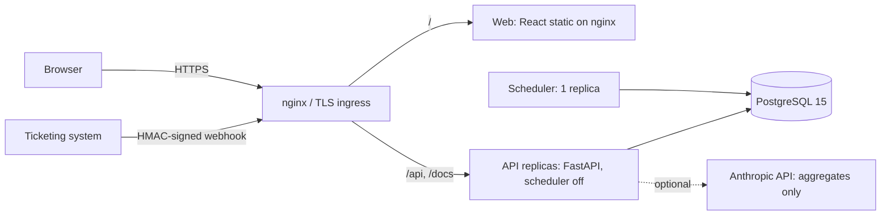

# Deployment

Local development uses `scripts/dev.sh` (SQLite, Vite on :5173, API on :8000). `docker-compose.yml` runs PostgreSQL,
API, web and an optional TLS proxy. `deploy/k8s/` holds the Kubernetes reference manifests (HPA, NetworkPolicies,
restricted pod security).
